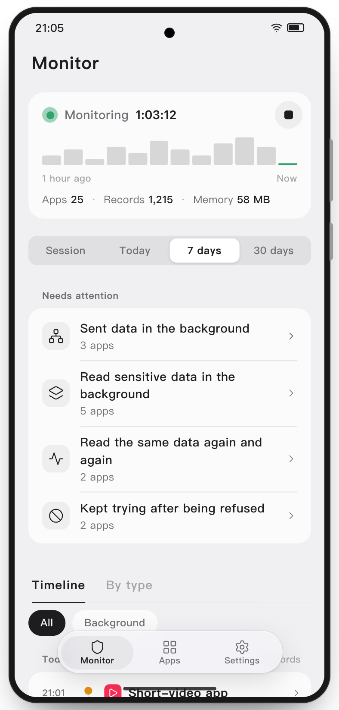
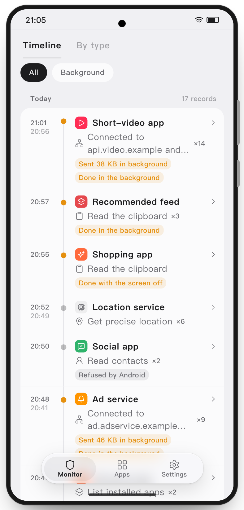
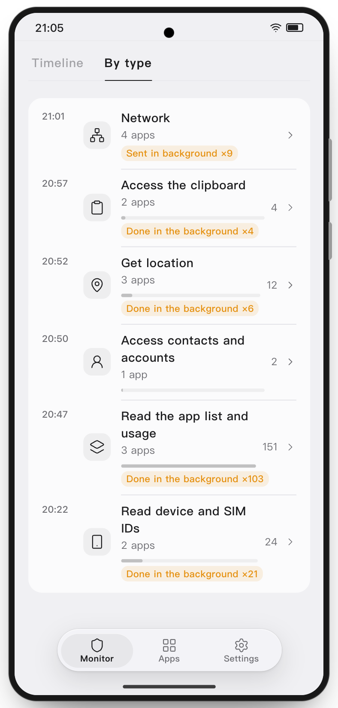
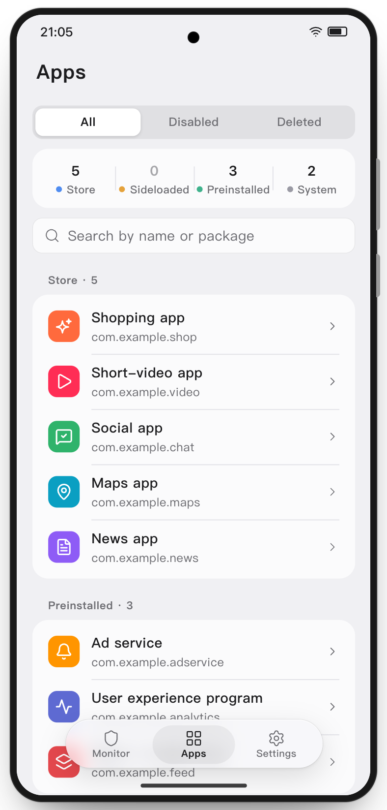
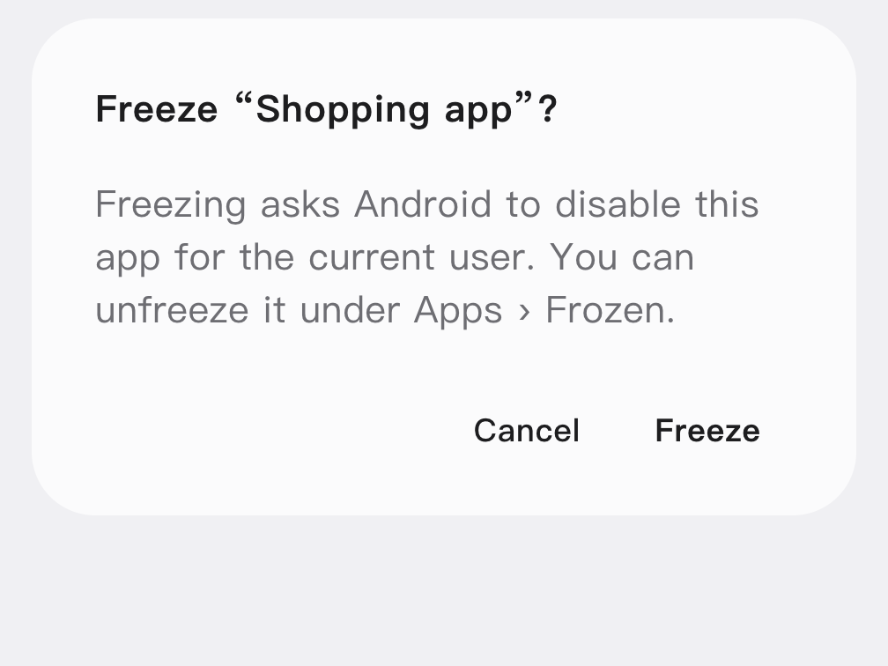
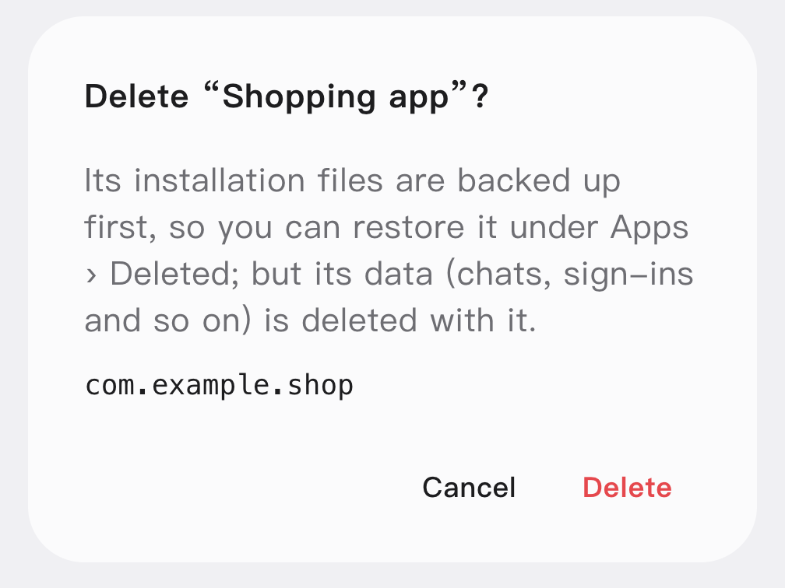
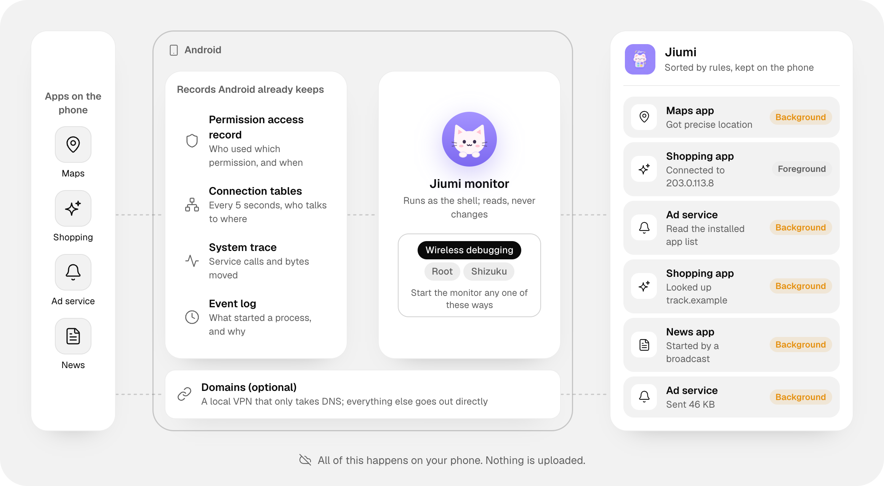

<div align="center">


# Jiumi 揪咪

Ein schlankes Tool für Android, mit dem du App-Aktivitäten überwachen und Apps verwalten kannst.
<br>Root-Zugriff und Computer sind nicht erforderlich. Die Aufzeichnungen bleiben auf deinem Smartphone.

**[APK herunterladen](https://github.com/ybblab/Jiumi/releases/latest)** · [Anleitung](https://jiumi.ybblab.com/en/download/) · [Website](https://jiumi.ybblab.com/en/)

<sub>Android 11 oder neuer · APK ca. 4 MB · <a href="LICENSE">Apache 2.0</a></sub>

[简体中文](README.md) · [English](README.en.md) · [日本語](README.ja.md) · [한국어](README.ko.md) · [Español](README.es.md) · **Deutsch** · [Français](README.fr.md) · [हिन्दी](README.hi.md) · [Bahasa Indonesia](README.id.md) · [Português (Brasil)](README.pt-BR.md) · [Русский](README.ru.md)

</div>

## Die App im Überblick

<p align="center">
  <a href="code/images/monitor.en.png"></a>&nbsp;
  <a href="code/images/timeline.en.png"></a>&nbsp;
  <a href="code/images/by-type.en.png"></a>&nbsp;
  <a href="code/images/apps.en.png"></a>
</p>

## Funktionen

| Funktion | Was du damit tun kannst |
| --- | --- |
| Aktivitätsprotokoll | Sieh dir **56 Zugriffsarten in 12 Gruppen** an, darunter Standort, Zwischenablage und Gerätekennungen. Zeige die Einträge nach Zeit, App oder Typ an und filtere sie nach Hintergrundaktivitäten. |
| Auffällige Aktivitäten | Prüfe Datenübertragungen und Zugriffe auf sensible Daten im Hintergrund, häufige Zugriffe und wiederholt abgelehnte Zugriffsversuche. |
| Netzwerkaktivität | Sieh dir pro App die Verbindungsadressen und verfügbaren Messwerte zum Datenverkehr an. Bei aktiver Domainerfassung können Verbindungen mit eindeutiger Zuordnung eine Domain anzeigen. |
| Systemverlauf | Öffne die App-Details, um die von Android gespeicherten Einträge und Gesamtzahlen zu Berechtigungszugriffen einzusehen. Dazu gehören auch einige Aktivitäten vor Beginn der Überwachung. |
| Protokollexport | Speichere unter **Settings › Export logs** die Einträge für einen ausgewählten Zeitraum als ZIP-Archiv mit CSV-Dateien. |
| Benachrichtigungen | Während der Überwachung zeigt eine kompakte Benachrichtigung die Laufzeit und eine Schaltfläche zum Beenden an. Unter **Settings › Notifications** kannst du sie abschalten. Optional zeigt sie die Anzahl der Apps und Einträge der Sitzung. Mit **Attention alerts** erhältst du bei einer neu erkannten Auffälligkeit eine Benachrichtigung, einmal je App und Auffälligkeit pro Sitzung. |

## Apps verwalten

Die Apps sind nach Installationsquelle gruppiert. Öffne die Details einer App, um ihre Aktivitäten zu prüfen und zu entscheiden, ob du etwas ändern möchtest. Du stößt die Verwaltungsaktionen an. Nach jeder Änderung liest Jiumi den Zustand von Android erneut aus, um zu prüfen, ob die Änderung wirksam wurde. Wenn Android sie ablehnt, zeigt Jiumi den Grund an.

<p align="center">
  <a href="code/images/app-disable.en.png"></a>&nbsp;
  <a href="code/images/app-delete.en.png"></a>&nbsp;
  <a href="code/images/app-restore.en.png"></a>
</p>

| Aktion | Was dabei passiert |
| --- | --- |
| Berechtigungen | Unter **Permissions** in den App-Details kannst du Berechtigungen einzeln aus- und einschalten. Mit **Manageable permissions** schaltest du alle verwaltbaren Berechtigungen auf einmal aus. Beim Wiedereinschalten stellt Jiumi nur die Berechtigungen wieder her, die es selbst ausgeschaltet hat. Vom System gesperrte Berechtigungen werden als schreibgeschützt angezeigt. |
| Netzwerkzugriff | Auf unterstützten Geräten kannst du den Netzwerkzugriff einer einzelnen App mit der Android-eigenen Firewall sperren oder wiederherstellen. Der VPN-Platz bleibt dabei frei. Der Schalter wird mit Angabe des Grundes gesperrt, wenn die App eine UID mit anderen Apps teilt, ein anderes Tool die Regel gesetzt hat oder Jiumi nicht bestätigen kann, dass nur diese App betroffen ist. |
| Einfrieren oder auftauen | Beim Einfrieren deaktiviert Android die App für den aktuellen Benutzer und behält ihre Daten. Unter **Apps › Frozen** kannst du sie wieder aktivieren. Eingefrorene Apps tragen ein Schneeflockensymbol. |
| Einfrieren aufgehoben | Stellt Jiumi fest, dass eine von ihm eingefrorene App wieder aktiviert ist, erscheint **Freeze lifted** in der Liste und in den App-Details. Der Zeitverlauf hält den Zeitpunkt der Erkennung fest. Wer die App aktiviert hat, ist nicht bekannt. Wenn du **Settings › App management › Freeze again when a freeze is lifted** einschaltest, friert Jiumi sie erneut ein. |
| Selbst installierte App löschen | Gib zur Bestätigung den vollständigen Paketnamen ein. Vor der Deinstallation sichert Jiumi die Basis-APK und alle vorhandenen Split-APKs. Unter **Apps › Deleted** kannst du versuchen, die App erneut zu installieren. **Bei der Deinstallation werden die App-Daten gelöscht. Mit der Sicherung lassen sich nur die Installationsdateien wiederherstellen.** |
| Vorinstallierte App entfernen | Aktiviere die Option unter **Settings › App management**, um unterstützte vorinstallierte Apps für den aktuellen Benutzer zu entfernen. Die Systemkopie und die App-Daten bleiben erhalten. Unter **Apps › Deleted** kannst du versuchen, die App wiederherzustellen. Entfernte Apps tragen ein Papierkorbsymbol. |

Unter **Settings › App management** zeigt **Runs as**, mit welcher Benutzerkennung die Aktionen ausgeführt werden. Mit Root-Zugriff oder mit als Root gestartetem Shizuku werden Einfrieren, Auftauen, Löschen für den aktuellen Benutzer und Wiederherstellen als Root ausgeführt. So kann Jiumi auch System-Apps ändern, die der Shell-Benutzer auf dem Gerät nicht ändern darf. Beim drahtlosen Debugging erfolgen diese Aktionen als Shell-Benutzer. Wenn das Gerät Änderungen an einer System-App blockiert, zeigt Jiumi den Grund an. Das Deinstallieren einer selbst installierten App betrifft nur den aktuellen Benutzer. Eine Kopie im Arbeitsprofil oder in einem zweiten Bereich bleibt erhalten.

Wichtige Systemkomponenten sind standardmäßig geschützt. Änderungen an einer Komponente, auf die das Smartphone angewiesen ist, können Systemfunktionen beeinträchtigen. Jiumi warnt vor solchen Änderungen.

## Wie erkennt Jiumi Hintergrundaktivitäten ohne Root-Zugriff?

Während Apps laufen, stellt Android Protokolle zu Berechtigungszugriffen, Verbindungstabellen, System-Traces und Ereignisprotokolle bereit. Der Jiumi-Monitor liest die verfügbaren Systemsignale als **Shell-Benutzer**. Die App ordnet sie anhand von Regeln und speichert sie in einer Datenbank auf deinem Smartphone. Die Überwachung schleust keinen Code in andere Apps ein. Aktionen wie Einfrieren, Löschen, Entziehen von Berechtigungen oder Sperren des Netzwerkzugriffs musst du in der App-Verwaltung selbst auslösen.

<p align="center"></p>

| Signalquelle | Was Jiumi erkennen kann |
| --- | --- |
| Protokolle zu Berechtigungszugriffen (AppOps) | Welche App wann eine Berechtigung genutzt hat, einschließlich des von Android gespeicherten Verlaufs. |
| Verbindungstabellen | Mit welchen Adressen sich Apps verbunden haben. Standardmäßig werden die Tabellen alle fünf Sekunden abgetastet. |
| System-Traces (Perfetto) | Erkennbare Aufrufe von Systemdiensten und Datenverkehr pro Verbindung, sofern das System dies unterstützt. |
| Ereignisprotokolle | Wann ein Prozess gestartet wurde und welchen Grund Android dafür erfasst hat. |

**Wähle drahtloses Debugging, Shizuku oder Root.** Bei allen drei Methoden läuft der Monitor als Shell-Benutzer. Das drahtlose Debugging lässt sich direkt auf dem Smartphone koppeln. Shizuku kann über ADB oder mit Root-Rechten gestartet werden. Jiumi benötigt dabei deine Freigabe. Bei der Root-Option wechselt Jiumi zum Shell-Benutzer, um den Monitor zu starten. Einfrieren, Auftauen, Löschen für den aktuellen Benutzer und Wiederherstellen werden direkt als Root ausgeführt. So kann Jiumi Apps ändern, für die Android Änderungen durch den Shell-Benutzer blockiert. Dasselbe gilt für als Root gestartetes Shizuku.

Die **optionale Domainerfassung** empfängt DNS-Anfragen über ein lokales VPN und leitet sie unverändert an die DNS-Server des aktuellen Netzwerks weiter. Der übrige Datenverkehr geht direkt ans Ziel. Die Domainerfassung belegt den VPN-Platz des Systems. Wenn eine App eigenes verschlüsseltes DNS nutzt oder ein privater DNS-Anbieter per Hostname konfiguriert ist, werden die Anfragen möglicherweise nicht erfasst.

## Herunterladen und Überwachung starten

1. Lade auf einem Smartphone mit Android 11 oder neuer die APK von [GitHub Releases](https://github.com/ybblab/Jiumi/releases/latest) herunter und installiere sie.
2. Wähle beim ersten Öffnen von Jiumi eine Startmethode. Für die empfohlene Methode, drahtloses Debugging, verbinde dich mit dem WLAN und folge der Einrichtung, um Benachrichtigungen zu erlauben und die Entwickleroptionen zu aktivieren. Gib in der Benachrichtigung von Jiumi den sechsstelligen Kopplungscode ein, den Android anzeigt.
3. Tippe auf der Seite **Monitor** auf **Start monitoring**. Während der Überwachung erscheint eine dauerhafte Benachrichtigung. Du kannst die Überwachung über die Benachrichtigung oder in der App beenden.

Nach einem Neustart, einem Jiumi-Update oder einer Unterbrechung des Debugging-Dienstes setzt Jiumi dieselbe Sitzung automatisch fort, sobald die gewählte Verbindung wieder verfügbar ist. Wenn die Karte **Monitoring interrupted** anzeigt, stelle die gewählte Verbindung wieder her und tippe auf **Resume**. Die Zeit der Unterbrechung zählt nicht zur Überwachungsdauer.

Wenn du drahtloses Debugging nutzt, kann zusätzlich aktiviertes USB-Debugging den laufenden Monitor aufrechterhalten, falls Android beim Verlust der WLAN-Verbindung das drahtlose Debugging abschaltet. Die ADB-Persistenz ist standardmäßig aus. Wenn du sie einschaltest, wird ein Port nur dann erneut genutzt, wenn das Gerät bereits einen verifizierten Listener an der Loopback-Schnittstelle bereitstellt. Details findest du in der [Einrichtungsanleitung](https://jiumi.ybblab.com/en/download/).

## Datenschutz und Grenzen

- **Die Aufzeichnungen bleiben auf deinem Smartphone.** Jiumi verwendet keine Benutzerkonten und lädt keine Überwachungsdaten hoch. Die App kann auf GitHub nach Updates suchen. Wenn du ein Update auswählst, lädt sie die APK herunter und prüft Dateigröße, SHA-256-Prüfsumme und Signatur. Die Updatesuche lässt sich abschalten.
- **Die Einträge beschreiben Aktivitäten und Verbindungen.** Jiumi kann anzeigen, dass eine Berechtigung verwendet oder ein Zugriff abgelehnt wurde. Nachrichten, Passwörter und Inhalte des Netzwerkverkehrs kann die App nicht einsehen.
- **Was erfasst werden kann, hängt vom System ab.** Kurze Verbindungen können zwischen zwei Abfragen enden. Aktionen wie direkte Dateizugriffe liefern möglicherweise kein auswertbares Signal. Messwerte zum Datenverkehr pro Verbindung setzen Android 14 oder neuer und passende Systemunterstützung voraus. Jiumi lässt einige nicht bestätigbare Aktivitäten weg, um Fehlmeldungen zu reduzieren.
- **Die Überwachung verbraucht zusätzlich Akku.** Wie viel, hängt von der App-Aktivität ab. Beende die Überwachung über die Benachrichtigung, wenn du sie nicht mehr brauchst.

## Aus dem Quellcode bauen

Du brauchst JDK 17 und das Android SDK.

```sh
cd code
./gradlew :app:assembleDebug
```

Überwachungskategorien, Regeln für Auffälligkeiten und geschützte Apps sind im [Regelverzeichnis](code/app/src/main/assets/rules/) konfiguriert. Den Aufbau des Codes und Hinweise zur Mitarbeit findest du in [CONTRIBUTING.md](CONTRIBUTING.md).

## Mitarbeit und Lizenz

Issues und Pull Requests sind willkommen. Bitte melde Sicherheitsprobleme vertraulich nach den Hinweisen in [SECURITY.md](SECURITY.md).

Jiumi steht unter der [Apache License 2.0](LICENSE). Drittanbieterkomponenten und ihre Lizenzen stehen in [NOTICE](NOTICE). Verwende Jiumi auf Geräten, die dir gehören oder die du mit Erlaubnis nutzen darfst.

## Verlauf der GitHub-Sterne

<a href="https://www.star-history.com/#ybblab/Jiumi&amp;Date">
  <picture>
    <source media="(prefers-color-scheme: dark)" srcset="https://api.star-history.com/svg?repos=ybblab/Jiumi&amp;type=Date&amp;theme=dark" />
    
  </picture>
</a>

<div align="center">

**Wenn Jiumi dir hilft, die Aktivitäten deiner Apps zu verstehen, gib dem Projekt auf GitHub einen ⭐.**

</div>
