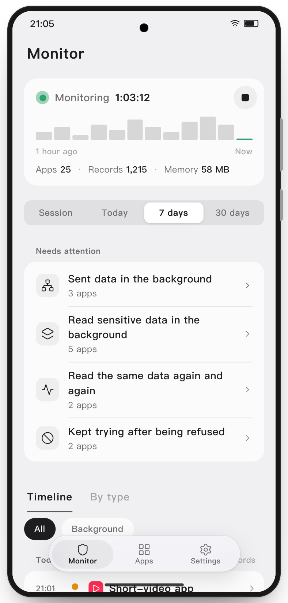
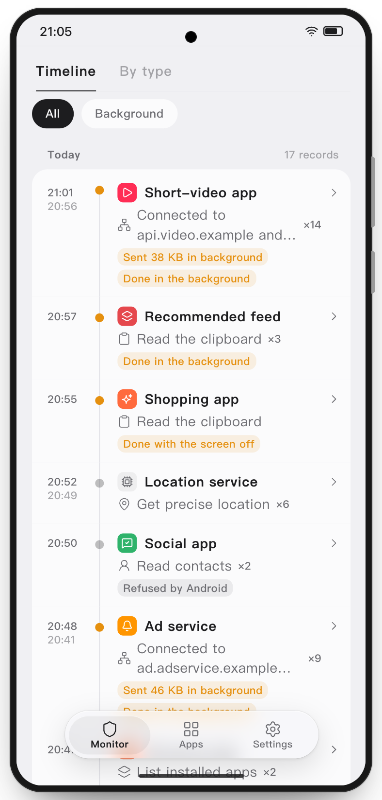
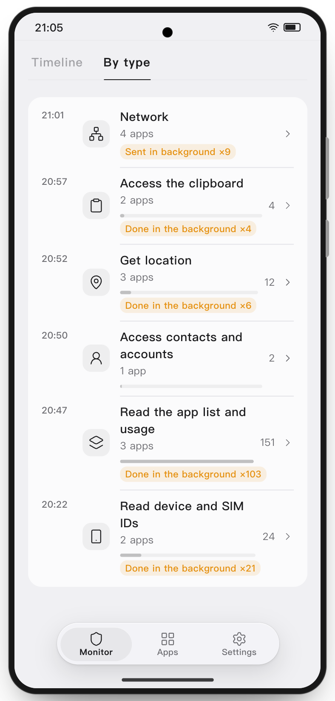
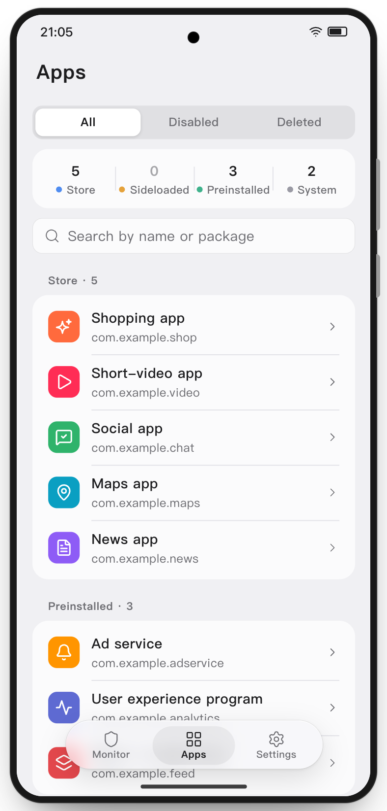
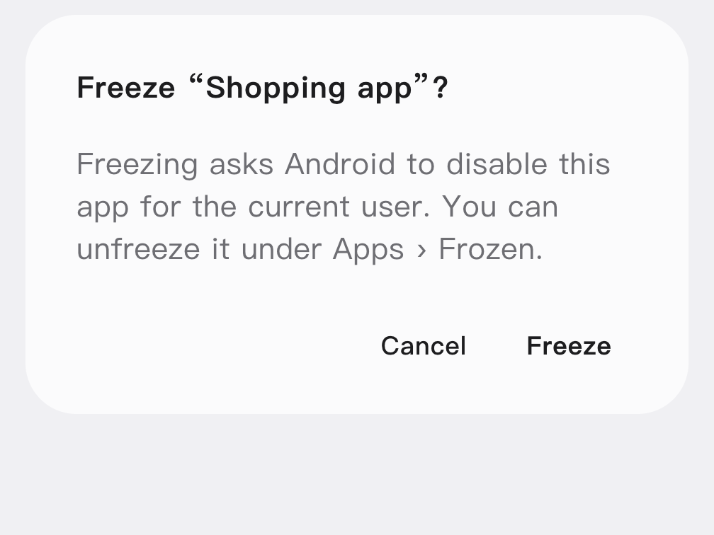
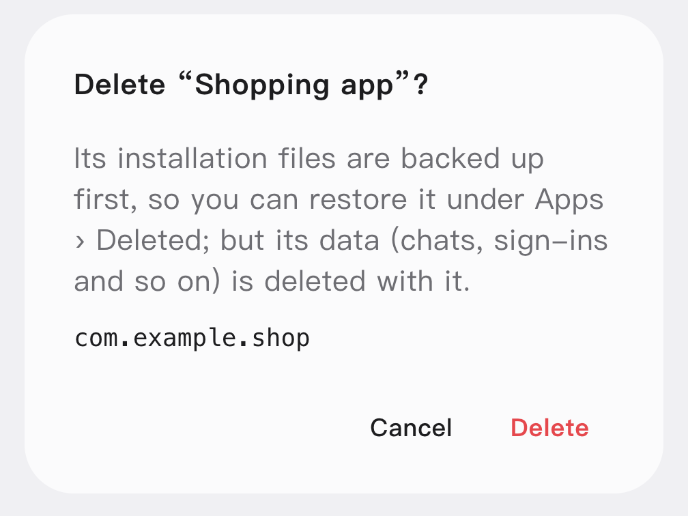
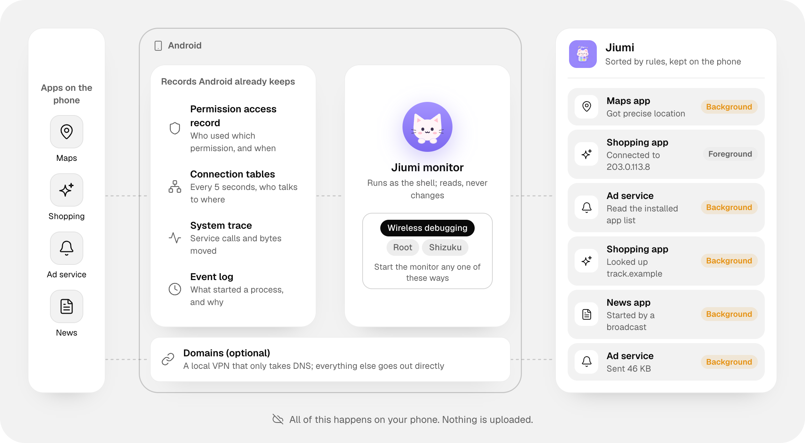

<div align="center">


# Jiumi 揪咪

A lightweight Android app behavior monitor and manager.
<br>No root or computer needed. Records stay on your phone.

**[Download APK](https://github.com/ybblab/Jiumi/releases/latest)** · [Guide](https://jiumi.ybblab.com/en/download/) · [Website](https://jiumi.ybblab.com/en/) · [简体中文](README.md)

<sub>Android 11 and later · APK about 4 MB · <a href="LICENSE">Apache 2.0</a></sub>

</div>

## A quick look at the app

<p align="center">
  <a href="code/images/monitor.en.png"></a>&nbsp;
  <a href="code/images/timeline.en.png"></a>&nbsp;
  <a href="code/images/by-type.en.png"></a>&nbsp;
  <a href="code/images/apps.en.png"></a>
</p>

## Features

| Feature | What you can do |
| --- | --- |
| Activity records | Browse **56 types of access in 12 groups**, including location, clipboard and device identifiers. View records by time, app or type, and filter for background activity. |
| Needs attention | Review background transfers, sensitive access in the background, frequent access and repeated denied attempts. |
| Network activity | See connection addresses and available traffic measurements by app. With domain recording enabled, matched connections can show a domain. |
| System history | Open an app's details to see the permission access records and totals Android retains, including some activity from before monitoring began. |
| Log export | In Settings › Export logs, save records for a selected time range as a ZIP containing CSV files. |
| Notifications | While monitoring, a compact notification shows how long it has run, with a stop button; turn it off in Settings › Notifications. It can also show the session's app and record counts. With Attention alerts on, you are notified when an app newly raises an item that needs attention, once per app and item in a session. |

## Manage apps

Apps are grouped by source. Open an app's details to review its activity and decide whether to make a change. App management actions start with you. After each change, Jiumi reads the state back from Android to confirm it took effect, and shows the reason if Android refuses.

<p align="center">
  <a href="code/images/app-disable.en.png"></a>&nbsp;
  <a href="code/images/app-delete.en.png"></a>&nbsp;
  <a href="code/images/app-restore.en.png"></a>
</p>

| Action | What happens |
| --- | --- |
| Permissions | Turn permissions off or on one at a time under Permissions in the app's details. Manageable permissions turns them all off at once; turning it back on restores only the permissions Jiumi turned off. Permissions the system locks are shown as read only. |
| Network access | On supported devices, block or restore network access for a single app with Android's own firewall, without using the VPN slot. The switch is locked with a reason when the app shares a UID with other apps, the rule was set by another tool, or Jiumi cannot confirm that only this app is affected. |
| Freeze or unfreeze | Freezing has Android disable the app for the current user and keeps its data. Unfreeze it under Apps › Frozen. Frozen apps carry a snowflake badge. |
| Freeze lifted | When an app Jiumi froze is found turned on again, the list and its details mark it Freeze lifted, and the timeline records when it was found; who turned it on is not known. With Settings › App management › Freeze again when a freeze is lifted on, Jiumi freezes it again. |
| Delete an app you installed | Enter the full package name to confirm. Jiumi backs up the APKs before uninstalling. You can try to reinstall the app from Apps › Deleted. **Uninstalling deletes app data. The backup can only restore the installation files.** |
| Remove a preinstalled app | Enable the option in Settings › App management to remove supported preinstalled apps for the current user. The system copy and app data are kept, and you can try to restore the app from Apps › Deleted. Deleted apps carry a trash badge. |

Runs as, in Settings › App management, shows who carries out these actions. With root, or Shizuku started with root, freezing, unfreezing, deleting for the current user and restoring run as root, so Jiumi can change system apps the phone does not let the shell change. With wireless debugging they run as the shell, and the phone does not let it change some system apps; Jiumi shows the reason. Uninstalling an app you installed affects only the current user, so a copy in a work profile or second space is kept.

Core system components are protected by default. Changing a component the phone depends on can affect system features. Jiumi displays a warning before such changes.

## How does Jiumi see background activity without root?

Android provides permission access records, connection tables, system traces and event logs as apps run. The Jiumi monitor reads available system signals as the **shell user**. The app organizes them by rules and stores them in a database on your phone. Monitoring does not inject code into other apps. Actions such as freezing, deleting, or turning off permissions or network access require you to start them in app management.

<p align="center"></p>

| Signal source | What Jiumi can see |
| --- | --- |
| Permission access records (AppOps) | Which app used a permission and when, along with the history Android retains. |
| Connection tables | Which addresses apps connected to, sampled every five seconds by default. |
| System traces (Perfetto) | Identifiable system service calls and per-connection traffic where the system supports it. |
| Event logs | When a process started and the reason Android recorded. |

**Choose wireless debugging, Shizuku or root.** The monitor runs as the shell user with all three. Wireless debugging pairs on the phone itself. Shizuku can be started over ADB or with root, and needs permission granted to Jiumi. The root option switches to the shell user to start the monitor; in addition, freezing, unfreezing, deleting for the current user and restoring apps run directly as root, so Jiumi can change apps Android does not let the shell change. The same goes for Shizuku started with root.

**Optional domain recording** uses a local VPN to receive DNS queries and forward them unchanged to the current network's DNS servers. Other traffic goes directly to its destination. Domain recording occupies the system VPN slot, and queries using an app's own encrypted DNS or a named Private DNS provider may bypass it.

## Download and start monitoring

1. On a phone running Android 11 or later, download and install the APK from [GitHub Releases](https://github.com/ybblab/Jiumi/releases/latest).
2. Choose a launch method on first opening Jiumi. For wireless debugging, the recommended method, connect to Wi-Fi and follow the setup to allow notifications, turn on Developer options and enter the six-digit system pairing code in Jiumi's notification.
3. Tap Start monitoring on the Monitor page. A persistent notification appears while monitoring is running. You can stop monitoring from the notification or the app.

When monitoring is interrupted (a phone restart, a Jiumi update, or the debugging service ended by the system), Jiumi picks up the same session again where it can: with root or an authorized Shizuku it resumes on its own; with wireless debugging it resumes only while the debugging channel is still available, and otherwise the card shows Monitoring interrupted and you tap Resume once on Wi-Fi. Interrupted time does not count toward monitored time.

With wireless debugging, turning on USB debugging as well is recommended: without it, a running monitor ends when Android turns wireless debugging off, for example on leaving or changing Wi-Fi. USB debugging also enables ADB persistence, which lets you start or resume offline until the next restart; changing that switch while monitoring takes effect the next time monitoring starts or stops. See the [setup guide](https://jiumi.ybblab.com/en/download/) for details.

## Privacy and limitations

- **Records stay on your phone.** Jiumi has no accounts and does not upload monitoring records. The app can check GitHub for updates. If you choose to update, it downloads the APK and verifies its size, SHA-256 and signature. You can turn off update checks.
- **Records describe activity and connections.** Jiumi can show that a permission was used or an access was denied. It cannot see messages, passwords or the contents of network transfers.
- **Coverage depends on the system.** Short connections can end between samples, and actions such as direct file reads may produce no usable signal. Per-connection traffic requires Android 14 or later and system support. Jiumi leaves out some activity it cannot confirm to reduce false reports.
- **Monitoring uses extra battery.** The amount depends on app activity. Stop monitoring from the notification when you no longer need it.

## Build from source

Requires JDK 17 and the Android SDK.

```sh
cd code
./gradlew :app:assembleDebug
```

Monitoring categories, attention rules and protected apps are configured in the [rules directory](code/app/src/main/assets/rules/). See [CONTRIBUTING.md](CONTRIBUTING.md) for the code layout and contribution process.

## Contributing and license

Issues and pull requests are welcome. Report security issues privately as described in [SECURITY.md](SECURITY.md).

Jiumi is licensed under the [Apache License 2.0](LICENSE). Third-party components and their licenses are listed in [NOTICE](NOTICE). Use Jiumi on devices you own or are authorized to use.

## Star history

<a href="https://www.star-history.com/#ybblab/Jiumi&amp;Date">
  <picture>
    <source media="(prefers-color-scheme: dark)" srcset="https://api.star-history.com/svg?repos=ybblab/Jiumi&amp;type=Date&amp;theme=dark" />
    
  </picture>
</a>

<div align="center">

**If Jiumi helps you see what your apps are doing, give us a ⭐ on GitHub!**

</div>
