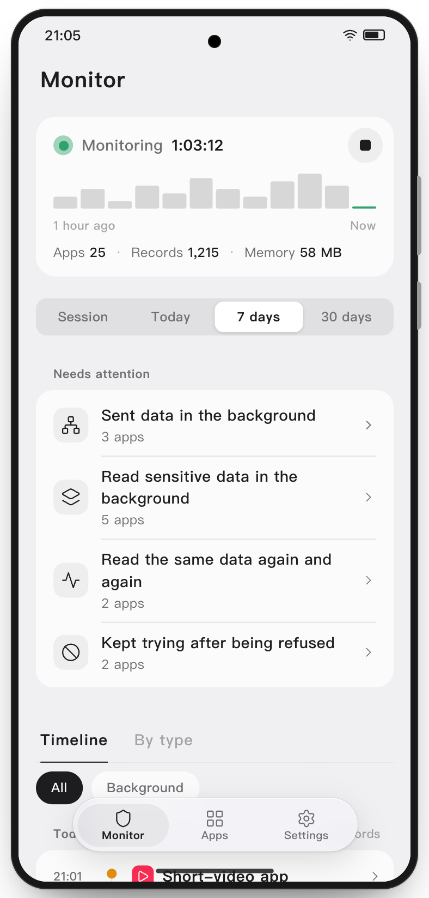
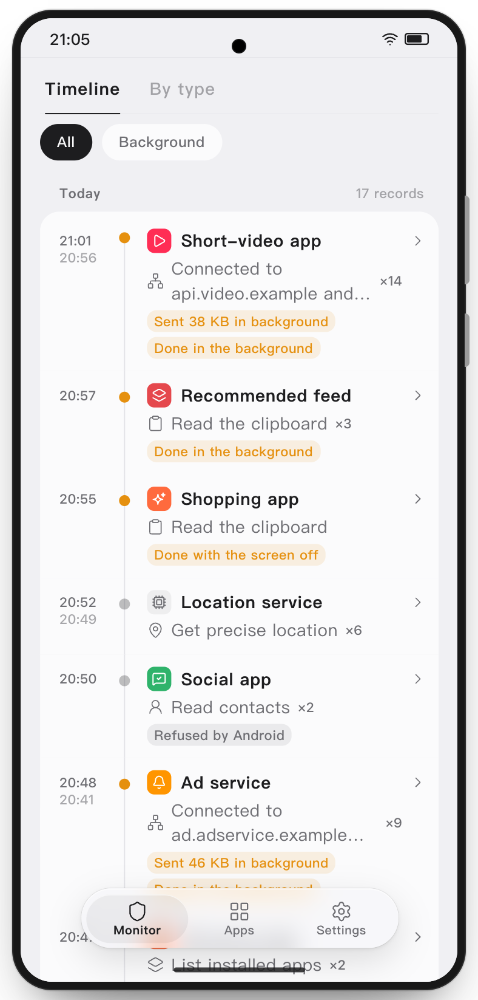
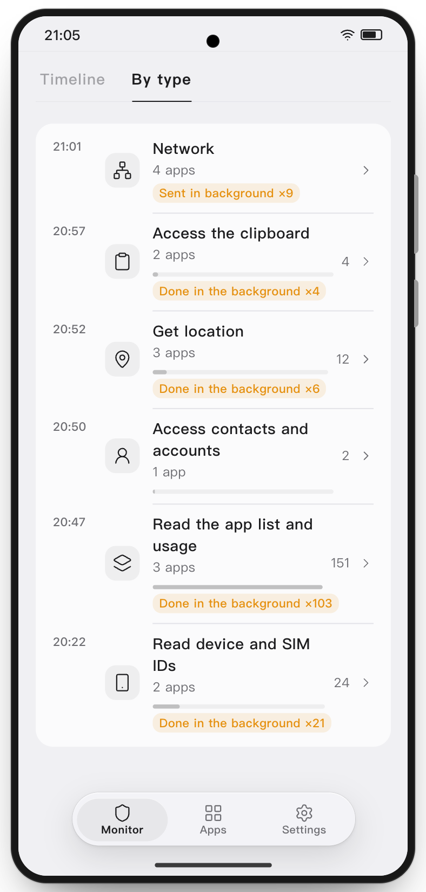
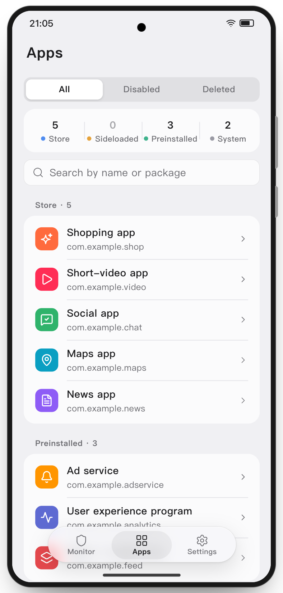
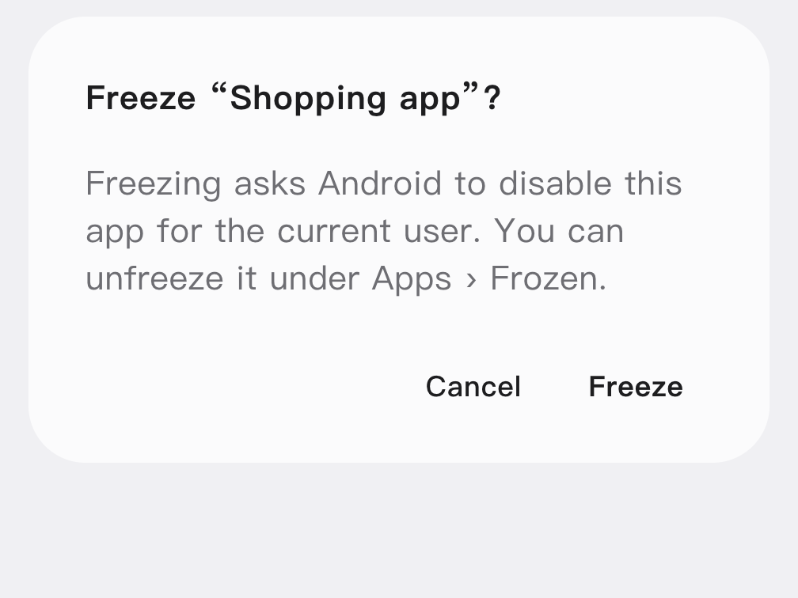
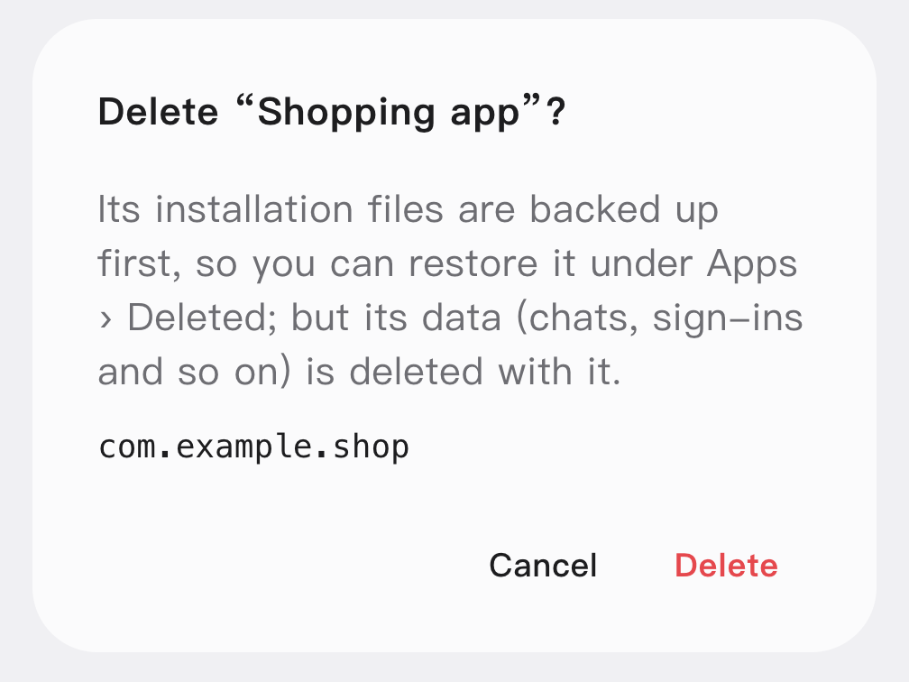
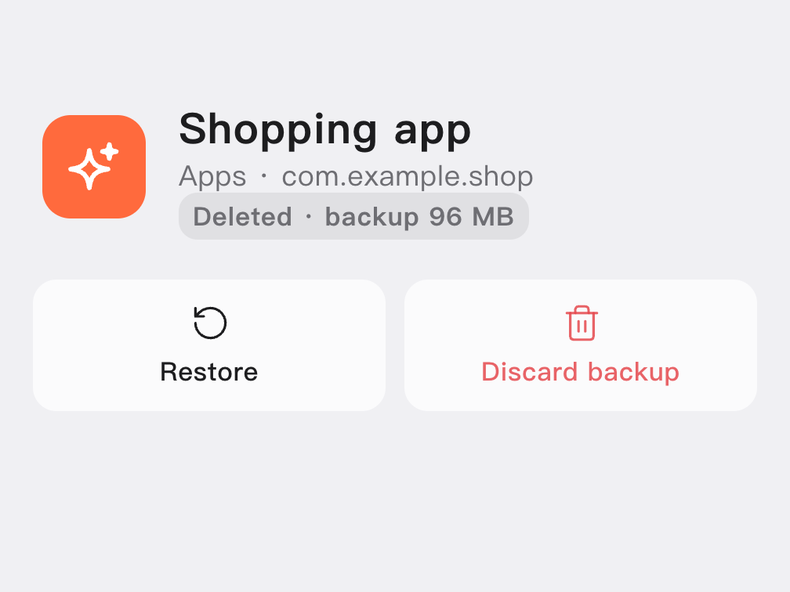
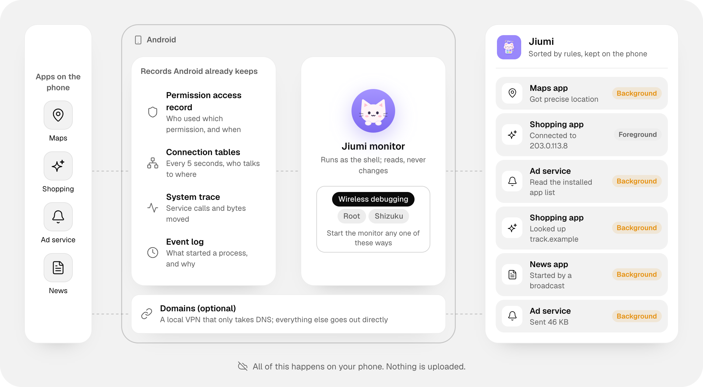

<div align="center">


# Jiumi 揪咪

Una herramienta ligera para monitorizar la actividad de las aplicaciones de Android y gestionarlas.
<br>No requiere root ni computadora. Los registros se guardan en el teléfono.

**[Descargar el APK](https://github.com/ybblab/Jiumi/releases/latest)** · [Guía](https://jiumi.ybblab.com/en/download/) · [Sitio web](https://jiumi.ybblab.com/en/)

<sub>Android 11 o posterior · APK de unos 4 MB · <a href="LICENSE">Apache 2.0</a></sub>

[简体中文](README.md) · [English](README.en.md) · [日本語](README.ja.md) · [한국어](README.ko.md) · **Español** · [Deutsch](README.de.md) · [Français](README.fr.md) · [हिन्दी](README.hi.md) · [Bahasa Indonesia](README.id.md) · [Português (Brasil)](README.pt-BR.md) · [Русский](README.ru.md)

</div>

## Vistazo a la aplicación

<p align="center">
  <a href="code/images/monitor.en.png"></a>&nbsp;
  <a href="code/images/timeline.en.png"></a>&nbsp;
  <a href="code/images/by-type.en.png"></a>&nbsp;
  <a href="code/images/apps.en.png"></a>
</p>

## Funciones

| Función | Qué puedes hacer |
| --- | --- |
| Registros de actividad | Consulta **56 tipos de acceso en 12 grupos**, entre ellos la ubicación, el portapapeles y los identificadores del dispositivo. Puedes ver los registros por hora, aplicación o tipo, y filtrar la actividad en segundo plano. |
| Requiere atención | Revisa las transferencias en segundo plano, los accesos a datos sensibles en segundo plano, los accesos frecuentes y los intentos denegados repetidamente. |
| Actividad de red | Consulta las direcciones de conexión y las mediciones de tráfico disponibles para cada aplicación. Si activas el registro de dominios, las conexiones que se puedan asociar a un dominio lo mostrarán. |
| Historial del sistema | Abre los detalles de una aplicación para consultar los registros y totales de acceso a permisos que conserva Android, incluida parte de la actividad anterior al inicio de la monitorización. |
| Exportación de registros | En **Settings › Export logs**, guarda los registros de un período como un archivo ZIP que contiene archivos CSV. |
| Notificaciones | Durante la monitorización, una notificación compacta muestra el tiempo transcurrido y un botón de detención. Puedes desactivarla en **Settings › Notifications**. También puede mostrar el número de aplicaciones y de registros de la sesión. Si activas **Attention alerts**, recibirás un aviso cuando se detecte un nuevo motivo de atención, una sola vez por aplicación y motivo en cada sesión. |

## Gestión de aplicaciones

Las aplicaciones se agrupan por origen de instalación. Abre los detalles de una aplicación para revisar su actividad y decidir si quieres hacer algún cambio. Tú inicias las acciones de gestión. Después de cada cambio, Jiumi consulta el estado en Android para confirmar que se aplicó. Si Android lo rechaza, Jiumi muestra el motivo.

<p align="center">
  <a href="code/images/app-disable.en.png"></a>&nbsp;
  <a href="code/images/app-delete.en.png"></a>&nbsp;
  <a href="code/images/app-restore.en.png"></a>
</p>

| Acción | Qué ocurre |
| --- | --- |
| Permisos | Activa o desactiva los permisos uno por uno en **Permissions**, en los detalles de la aplicación. **Manageable permissions** desactiva de una vez todos los permisos que se pueden gestionar. Al volver a activar el interruptor, solo se restauran los que desactivó Jiumi. Los permisos que bloquea el sistema aparecen como de solo lectura. |
| Acceso a la red | En los dispositivos compatibles, puedes bloquear o restaurar el acceso a la red de una aplicación con el firewall de Android sin ocupar la ranura de VPN. El interruptor se bloquea y muestra el motivo si la aplicación comparte un UID con otras, si otra herramienta estableció la regla o si Jiumi no puede confirmar que solo se verá afectada esa aplicación. |
| Congelar o descongelar | Al congelar una aplicación, Android la deshabilita para el usuario actual y conserva sus datos. Puedes descongelarla en **Apps › Frozen**. Las aplicaciones congeladas llevan un distintivo con un copo de nieve. |
| Congelación levantada | Si Jiumi detecta que una aplicación que congeló vuelve a estar habilitada, la marca como **Freeze lifted** en la lista y en sus detalles, y registra la hora de detección en la cronología. No se sabe quién la habilitó. Si activas **Settings › App management › Freeze again when a freeze is lifted**, Jiumi volverá a congelarla. |
| Eliminar una aplicación que instalaste | Escribe el nombre completo del paquete para confirmar. Antes de desinstalar la aplicación, Jiumi guarda una copia del APK base y de los APK divididos que tenga. Puedes intentar reinstalarla desde **Apps › Deleted**. **La desinstalación borra los datos de la aplicación. La copia de seguridad solo permite recuperar los archivos de instalación.** |
| Quitar una aplicación preinstalada | Activa la opción en **Settings › App management** para quitar aplicaciones preinstaladas compatibles para el usuario actual. La copia del sistema y los datos de la aplicación se conservan. Puedes intentar restaurarla desde **Apps › Deleted**. Las aplicaciones eliminadas llevan un distintivo con una papelera. |

El campo **Runs as**, en **Settings › App management**, indica con qué identidad se ejecutan estas acciones. Con root o con Shizuku iniciado como root, la congelación, la descongelación, la eliminación para el usuario actual y la restauración se ejecutan como root. Así Jiumi puede cambiar aplicaciones del sistema que el teléfono no permite modificar al usuario shell. Con la depuración inalámbrica, las acciones se ejecutan como usuario shell. Si el teléfono impide cambiar alguna aplicación del sistema, Jiumi explica el motivo. Desinstalar una aplicación que tú instalaste solo afecta al usuario actual, por lo que se conserva cualquier copia en un perfil de trabajo o en un segundo espacio.

Los componentes esenciales del sistema están protegidos de forma predeterminada. Cambiar un componente del que depende el teléfono puede afectar a funciones del sistema. Jiumi muestra un aviso antes de hacerlo.

## ¿Cómo detecta Jiumi la actividad en segundo plano sin root?

Mientras se ejecutan las aplicaciones, Android genera registros de acceso a permisos, tablas de conexiones, trazas del sistema y registros de eventos. El monitor de Jiumi lee las señales disponibles como **usuario shell**. La aplicación las organiza mediante reglas y las guarda en una base de datos en el teléfono. La monitorización no inyecta código en otras aplicaciones. Las acciones de congelar, eliminar, revocar permisos o cortar el acceso a la red requieren que las inicies desde la gestión de aplicaciones.

<p align="center"></p>

| Fuente de señales | Qué puede ver Jiumi |
| --- | --- |
| Registros de acceso a permisos (AppOps) | Qué aplicación usó un permiso y cuándo, junto con el historial que conserva Android. |
| Tablas de conexiones | A qué direcciones se conectaron las aplicaciones. De forma predeterminada se toma una muestra cada cinco segundos. |
| Trazas del sistema (Perfetto) | Llamadas identificables a servicios del sistema y tráfico por conexión cuando el sistema lo admite. |
| Registros de eventos | Cuándo se inició un proceso y qué motivo registró Android. |

**Elige entre depuración inalámbrica, Shizuku y root.** El monitor se ejecuta como usuario shell con los tres métodos. La depuración inalámbrica se puede emparejar en el propio teléfono. Shizuku se puede iniciar mediante ADB o con root y necesita que concedas permiso a Jiumi. Con la opción root se cambia al usuario shell para iniciar el monitor. La congelación, la descongelación, la eliminación para el usuario actual y la restauración de aplicaciones sí se ejecutan como root, lo que permite cambiar aplicaciones que Android no deja modificar al usuario shell. Lo mismo ocurre con Shizuku iniciado como root.

El **registro opcional de dominios** usa una VPN local para recibir consultas DNS y reenviarlas sin cambios a los servidores DNS de la red actual. El resto del tráfico va directamente a su destino. El registro de dominios ocupa la ranura de VPN del sistema. Las consultas que usan el DNS cifrado de una aplicación o un proveedor de DNS privado especificado por nombre de host pueden quedar fuera del registro.

## Descargar e iniciar la monitorización

1. En un teléfono con Android 11 o posterior, descarga e instala el APK desde [GitHub Releases](https://github.com/ybblab/Jiumi/releases/latest).
2. La primera vez que abras Jiumi, elige cómo iniciarlo. Si usas la depuración inalámbrica, que es el método recomendado, conéctate a Wi-Fi y sigue las indicaciones para permitir las notificaciones y activar las opciones de desarrollador. Introduce el código de emparejamiento de seis dígitos que muestra el sistema en la notificación de Jiumi.
3. Pulsa **Start monitoring** en la pantalla **Monitor**. Mientras la monitorización esté activa, aparecerá una notificación persistente. Puedes detenerla desde la notificación o desde la aplicación.

Después de reiniciar el teléfono, actualizar Jiumi o sufrir una interrupción del servicio de depuración, Jiumi reanuda automáticamente la misma sesión cuando vuelve a estar disponible la conexión seleccionada. Si la tarjeta muestra **Monitoring interrupted**, restablece la conexión seleccionada y pulsa **Resume**. El tiempo de interrupción no cuenta como tiempo de monitorización.

Si usas la depuración inalámbrica, activar también la depuración USB ayuda a mantener el monitor en funcionamiento si Android desactiva la depuración inalámbrica al perderse la conexión Wi-Fi. La persistencia de ADB está desactivada de forma predeterminada. Si la activas, solo se reutilizará un puerto si el dispositivo ya dispone de un servicio verificado que escucha en la interfaz de bucle local. Consulta la [guía de configuración](https://jiumi.ybblab.com/en/download/) para más detalles.

## Privacidad y limitaciones

- **Los registros se guardan en el teléfono.** Jiumi no tiene cuentas ni sube los registros de monitorización. Puede buscar actualizaciones en GitHub. Si decides actualizar, Jiumi descarga el APK y verifica su tamaño, su hash SHA-256 y su firma. Puedes desactivar la búsqueda de actualizaciones.
- **Los registros describen la actividad y las conexiones.** Jiumi puede mostrar que se usó un permiso o que se denegó un acceso. No puede ver mensajes, contraseñas ni el contenido del tráfico de red.
- **La cobertura depende del sistema.** Las conexiones breves pueden terminar entre dos muestras y algunas acciones, como la lectura directa de archivos, pueden no producir señales utilizables. Las estadísticas de tráfico por conexión requieren Android 14 o posterior y que el sistema las admita. Para reducir los falsos avisos, Jiumi omite parte de la actividad que no puede confirmar.
- **La monitorización consume más batería.** El consumo depende de la actividad de las aplicaciones. Cuando dejes de necesitarla, detén la monitorización desde la notificación.

## Compilar desde el código fuente

Se necesitan JDK 17 y el SDK de Android.

```sh
cd code
./gradlew :app:assembleDebug
```

Las categorías de monitorización, las reglas de los avisos y las aplicaciones protegidas se configuran en el [directorio de reglas](code/app/src/main/assets/rules/). Consulta [CONTRIBUTING.md](CONTRIBUTING.md) para conocer la estructura del código y cómo colaborar.

## Contribuciones y licencia

Los informes de problemas y las solicitudes de incorporación de cambios son bienvenidos. Informa de los problemas de seguridad por vía privada siguiendo las instrucciones de [SECURITY.md](SECURITY.md).

Jiumi se distribuye bajo la [licencia Apache 2.0](LICENSE). Los componentes de terceros y sus licencias figuran en [NOTICE](NOTICE). Usa Jiumi solo en dispositivos que sean tuyos o que estés autorizado a usar.

## Historial de estrellas

<a href="https://www.star-history.com/#ybblab/Jiumi&amp;Date">
  <picture>
    <source media="(prefers-color-scheme: dark)" srcset="https://api.star-history.com/svg?repos=ybblab/Jiumi&amp;type=Date&amp;theme=dark" />
    
  </picture>
</a>

<div align="center">

**Si Jiumi te ayuda a entender qué hacen tus aplicaciones, dale una ⭐ en GitHub.**

</div>
