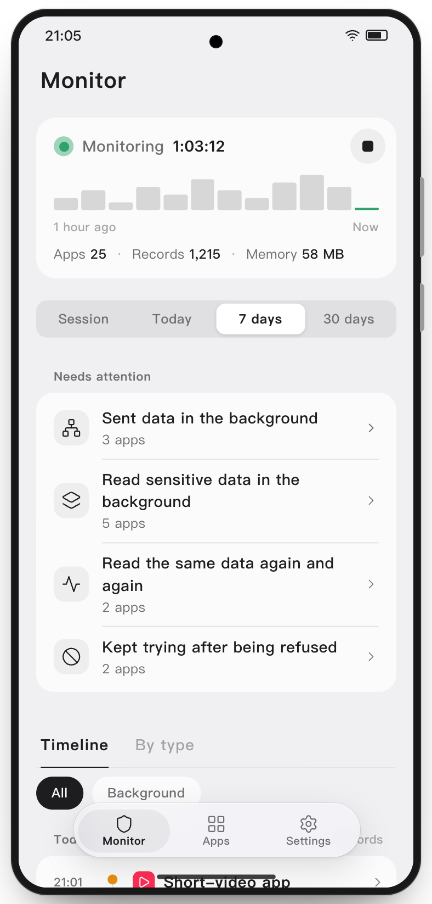
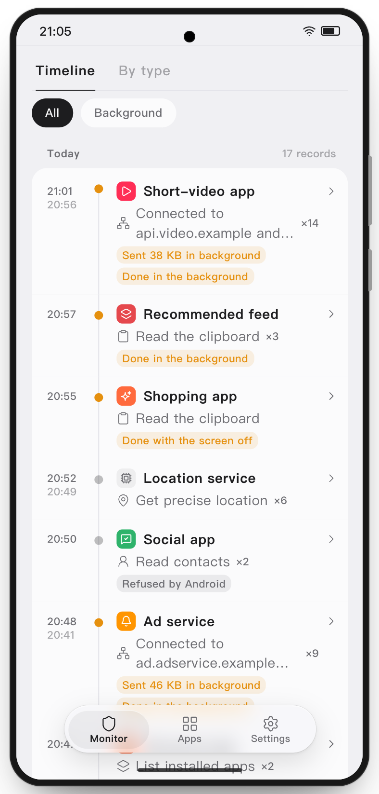
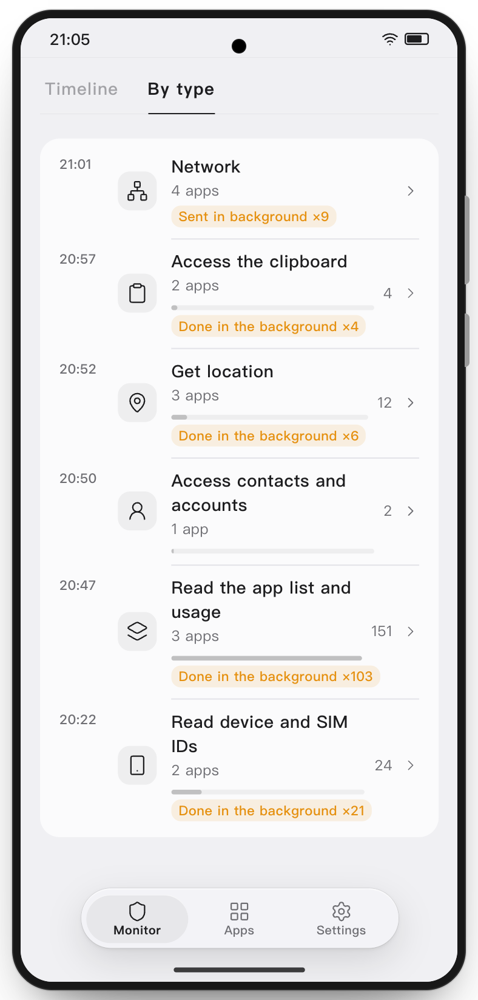
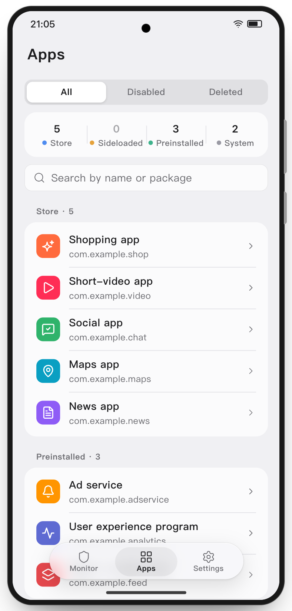
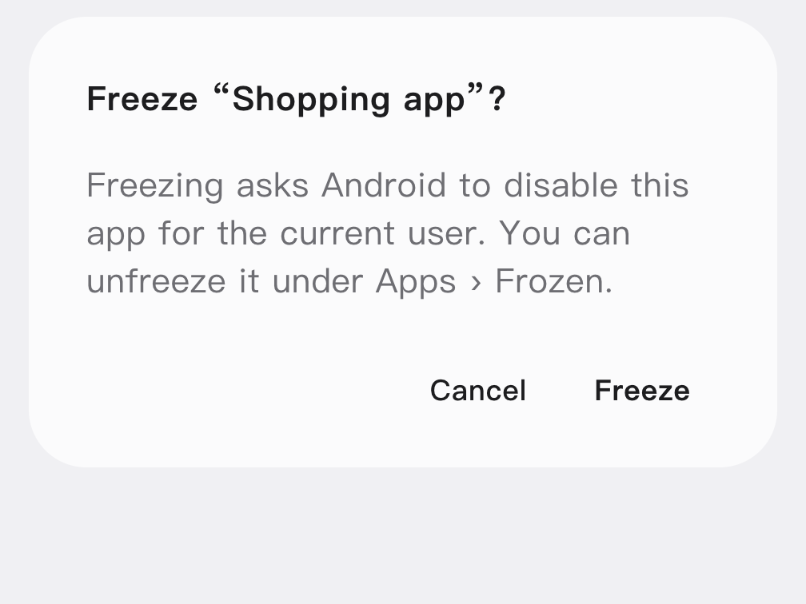
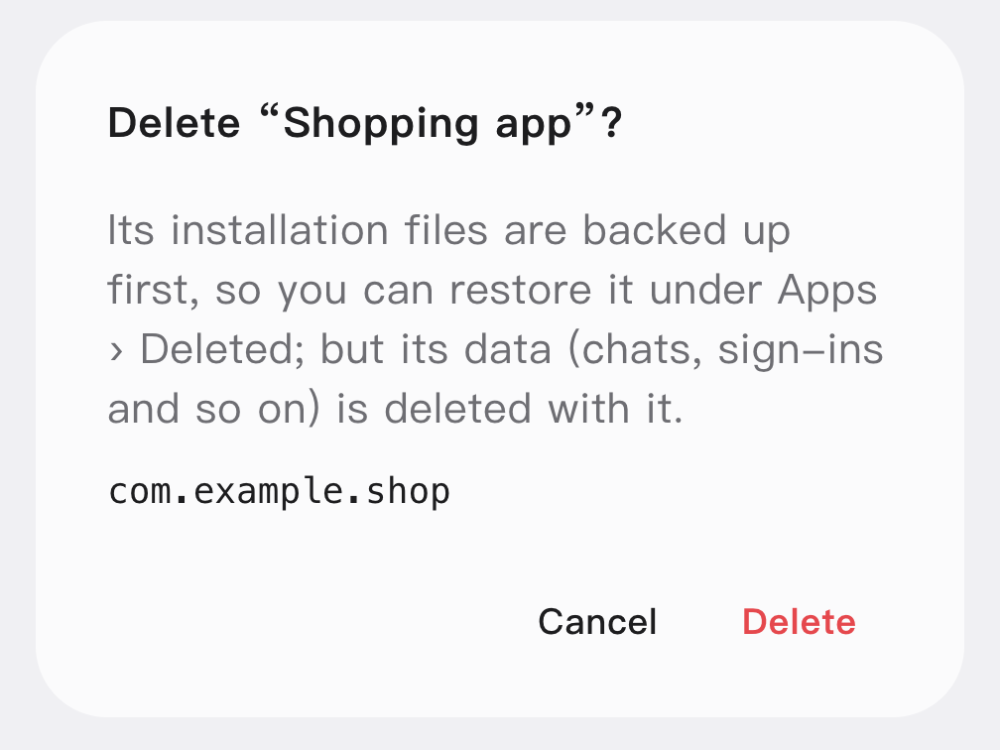
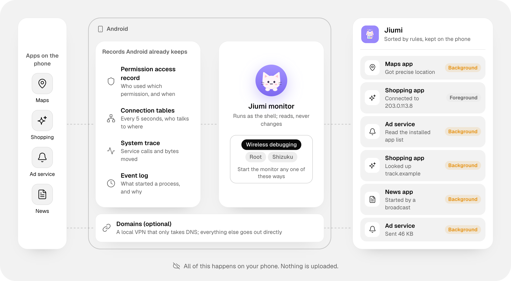

<div align="center">


# Jiumi 揪咪

Un outil léger pour surveiller l’activité des applications Android et les gérer.
<br>Aucun accès root ni ordinateur nécessaire. Les données enregistrées restent sur le téléphone.

**[Télécharger l’APK](https://github.com/ybblab/Jiumi/releases/latest)** · [Guide](https://jiumi.ybblab.com/en/download/) · [Site web](https://jiumi.ybblab.com/en/)

<sub>Android 11 ou version ultérieure · APK d’environ 4 Mo · <a href="LICENSE">Apache 2.0</a></sub>

[简体中文](README.md) · [English](README.en.md) · [日本語](README.ja.md) · [한국어](README.ko.md) · [Español](README.es.md) · [Deutsch](README.de.md) · **Français** · [हिन्दी](README.hi.md) · [Bahasa Indonesia](README.id.md) · [Português (Brasil)](README.pt-BR.md) · [Русский](README.ru.md)

</div>

## Aperçu de l’application

<p align="center">
  <a href="code/images/monitor.en.png"></a>&nbsp;
  <a href="code/images/timeline.en.png"></a>&nbsp;
  <a href="code/images/by-type.en.png"></a>&nbsp;
  <a href="code/images/apps.en.png"></a>
</p>

## Fonctionnalités

| Fonctionnalité | Ce que vous pouvez faire |
| --- | --- |
| Journal d’activité | Consultez **56 types d’accès répartis en 12 groupes**, dont les accès à la localisation, au presse-papiers et aux identifiants de l’appareil. Affichez les événements par heure, application ou type, et filtrez les activités en arrière-plan. |
| Activités à examiner | Consultez les transferts de données et les accès sensibles en arrière-plan, les accès fréquents et les tentatives refusées à plusieurs reprises. |
| Activité réseau | Consultez les adresses de connexion et les mesures de trafic disponibles pour chaque application. Lorsque la journalisation des domaines est activée, un domaine peut s’afficher pour les connexions auxquelles il a pu être associé. |
| Historique système | Ouvrez la fiche d’une application pour consulter les accès aux autorisations et les totaux conservés par Android. Ils incluent certaines activités qui précèdent le début de la surveillance. |
| Export des journaux | Dans **Settings › Export logs**, enregistrez le journal d’une période choisie dans une archive ZIP contenant des fichiers CSV. |
| Notifications | Pendant la surveillance, une notification compacte affiche le temps écoulé et un bouton d’arrêt. Vous pouvez la désactiver dans **Settings › Notifications**. Elle peut aussi afficher le nombre d’applications et d’événements enregistrés pendant la session. Si vous activez **Attention alerts**, vous recevrez une notification lorsqu’une nouvelle activité est à examiner, une fois par application et par type d’alerte au cours d’une session. |

## Gérer les applications

Les applications sont regroupées selon leur source d’installation. Ouvrez la fiche d’une application pour consulter son activité et décider si vous souhaitez intervenir. Vous déclenchez les actions de gestion. Après chaque modification, Jiumi relit l’état fourni par Android pour confirmer qu’elle a été appliquée. Si Android la refuse, Jiumi en affiche la raison.

<p align="center">
  <a href="code/images/app-disable.en.png"></a>&nbsp;
  <a href="code/images/app-delete.en.png"></a>&nbsp;
  <a href="code/images/app-restore.en.png"></a>
</p>

| Action | Résultat |
| --- | --- |
| Autorisations | Activez ou désactivez les autorisations une par une depuis **Permissions**, sur la fiche de l’application. **Manageable permissions** permet de désactiver toutes les autorisations modifiables à la fois. Lorsque vous réactivez cet interrupteur, seules les autorisations que Jiumi a désactivées sont rétablies. Les autorisations verrouillées par le système sont affichées en lecture seule. |
| Accès au réseau | Sur les appareils compatibles, bloquez ou rétablissez l’accès au réseau d’une application avec le pare-feu d’Android, sans occuper l’emplacement VPN. L’interrupteur est verrouillé et affiche la raison si l’application partage un UID avec d’autres applications, si un autre outil a défini la règle ou si Jiumi ne peut pas confirmer que seule cette application sera affectée. |
| Geler ou dégeler | Quand vous gelez une application, Android la désactive pour l’utilisateur actuel et conserve ses données. Vous pouvez la dégeler dans **Apps › Frozen**. Les applications gelées portent un symbole en forme de flocon. |
| Détection du dégel | Si Jiumi détecte qu’une application qu’il a gelée a été réactivée, **Freeze lifted** apparaît dans la liste et sur sa fiche. La chronologie indique l’heure de détection. Jiumi ne sait pas qui l’a réactivée. Si vous activez **Settings › App management › Freeze again when a freeze is lifted**, Jiumi gèle de nouveau l’application. |
| Supprimer une application que vous avez installée | Saisissez le nom complet du paquet pour confirmer. Avant la désinstallation, Jiumi sauvegarde l’APK de base et les APK fractionnés, s’il y en a. Vous pouvez tenter de réinstaller l’application depuis **Apps › Deleted**. **La désinstallation efface les données de l’application. La sauvegarde permet uniquement de restaurer les fichiers d’installation.** |
| Retirer une application préinstallée | Activez l’option dans **Settings › App management** pour retirer les applications préinstallées compatibles pour l’utilisateur actuel. La copie système et les données de l’application sont conservées. Vous pouvez tenter de restaurer l’application depuis **Apps › Deleted**. Les applications retirées portent un symbole en forme de corbeille. |

Dans **Settings › App management**, le champ **Runs as** indique sous quelle identité les actions sont exécutées. Avec un accès root, ou avec Shizuku lancé en root, le gel, le dégel, la suppression pour l’utilisateur actuel et la restauration s’exécutent en root. Jiumi peut ainsi modifier les applications système que le téléphone interdit à l’utilisateur shell de modifier. Avec le débogage sans fil, ces actions s’exécutent en tant qu’utilisateur shell. Si le téléphone bloque la modification d’une application système, Jiumi en affiche la raison. La désinstallation d’une application que vous avez installée ne concerne que l’utilisateur actuel. Une copie dans un profil professionnel ou un second espace est conservée.

Les composants essentiels du système sont protégés par défaut. Modifier un composant dont dépend le téléphone peut perturber certaines fonctions du système. Jiumi affiche un avertissement avant toute modification de ce type.

## Comment Jiumi détecte-t-il les activités en arrière-plan sans accès root ?

Pendant l’exécution des applications, Android fournit des journaux d’accès aux autorisations, des tables de connexions, des traces système et des journaux d’événements. Le moniteur de Jiumi lit les signaux disponibles en tant qu’**utilisateur shell**. L’application les organise à l’aide de règles et les enregistre dans une base de données sur votre téléphone. La surveillance n’injecte aucun code dans les autres applications. Vous devez déclencher vous-même le gel, la suppression ou la désactivation des autorisations ou de l’accès au réseau depuis la gestion des applications.

<p align="center"></p>

| Source des signaux | Ce que Jiumi peut voir |
| --- | --- |
| Journaux d’accès aux autorisations (AppOps) | Quelle application a utilisé une autorisation et à quel moment, avec l’historique conservé par Android. |
| Tables de connexions | Les adresses auxquelles les applications se sont connectées. Les tables sont relevées toutes les cinq secondes par défaut. |
| Traces système (Perfetto) | Les appels identifiables aux services système et le trafic par connexion quand le système le permet. |
| Journaux d’événements | Quand un processus a démarré et la raison enregistrée par Android. |

**Choisissez entre le débogage sans fil, Shizuku et l’accès root.** Dans les trois cas, le moniteur s’exécute en tant qu’utilisateur shell. Le débogage sans fil s’associe directement sur le téléphone. Shizuku peut être lancé via ADB ou en root, et vous devez autoriser Jiumi à l’utiliser. L’option root bascule vers l’utilisateur shell pour démarrer le moniteur. Le gel, le dégel, la suppression pour l’utilisateur actuel et la restauration s’exécutent directement en root. Jiumi peut ainsi modifier des applications qu’Android interdit à l’utilisateur shell de modifier. Il en va de même pour Shizuku lancé en root.

La **journalisation facultative des domaines** utilise un VPN local pour recevoir les requêtes DNS et les transmettre sans modification aux serveurs DNS du réseau utilisé. Le reste du trafic va directement à sa destination. La journalisation des domaines occupe l’emplacement VPN du système. Les requêtes envoyées via le DNS chiffré propre à une application ou via un fournisseur de DNS privé configuré par nom d’hôte peuvent échapper à la journalisation.

## Télécharger et démarrer la surveillance

1. Sur un téléphone équipé d’Android 11 ou d’une version ultérieure, téléchargez et installez l’APK depuis [GitHub Releases](https://github.com/ybblab/Jiumi/releases/latest).
2. Au premier lancement de Jiumi, choisissez un mode de démarrage. Pour le débogage sans fil, qui est le mode recommandé, connectez-vous au Wi-Fi et suivez la procédure pour autoriser les notifications et activer les options pour les développeurs. Saisissez dans la notification de Jiumi le code d’association à six chiffres affiché par le système.
3. Dans l’écran **Monitor**, appuyez sur **Start monitoring**. Une notification permanente s’affiche tant que la surveillance est active. Vous pouvez arrêter la surveillance depuis la notification ou l’application.

Après un redémarrage du téléphone, une mise à jour de Jiumi ou une interruption du service de débogage, Jiumi reprend automatiquement la même session dès que la connexion sélectionnée est disponible. Si la carte affiche **Monitoring interrupted**, rétablissez cette connexion puis appuyez sur **Resume**. Le temps d’interruption n’est pas compté dans la durée de surveillance.

Si vous utilisez le débogage sans fil, activer aussi le débogage USB aide à maintenir le moniteur en cours d’exécution si Android désactive le débogage sans fil à la perte du Wi-Fi. La persistance ADB est désactivée par défaut. Si vous l’activez, un port n’est réutilisé que si l’appareil dispose déjà d’un service vérifié à l’écoute sur l’interface de bouclage. Consultez le [guide de configuration](https://jiumi.ybblab.com/en/download/) pour plus de détails.

## Confidentialité et limites

- **Les données enregistrées restent sur votre téléphone.** Jiumi ne gère aucun compte et ne transfère pas les journaux de surveillance. L’application peut rechercher des mises à jour sur GitHub. Si vous choisissez d’effectuer une mise à jour, elle télécharge l’APK et vérifie sa taille, son empreinte SHA-256 et sa signature. La recherche de mises à jour peut être désactivée.
- **Le journal décrit les activités et les connexions.** Jiumi peut signaler qu’une autorisation a été utilisée ou qu’un accès a été refusé. Il ne peut pas lire les messages, les mots de passe ni le contenu du trafic réseau.
- **La couverture dépend du système.** Les connexions brèves peuvent se terminer entre deux relevés. Certaines actions, comme la lecture directe de fichiers, peuvent ne produire aucun signal exploitable. La mesure du trafic par connexion exige Android 14 ou une version ultérieure et doit être prise en charge par le système. Jiumi écarte certaines activités qu’il ne peut pas confirmer afin de limiter les fausses alertes.
- **La surveillance augmente la consommation de batterie.** La consommation dépend de l’activité des applications. Arrêtez la surveillance depuis la notification lorsque vous n’en avez plus besoin.

## Compiler à partir du code source

JDK 17 et le SDK Android sont requis.

```sh
cd code
./gradlew :app:assembleDebug
```

Les catégories de surveillance, les règles d’alerte et les applications protégées sont définies dans le [répertoire des règles](code/app/src/main/assets/rules/). Consultez [CONTRIBUTING.md](CONTRIBUTING.md) pour connaître l’organisation du code et la marche à suivre pour contribuer.

## Contributions et licence

Les signalements de problèmes et les demandes de modification sont les bienvenus. Signalez les problèmes de sécurité en privé en suivant les indications de [SECURITY.md](SECURITY.md).

Jiumi est distribué sous [licence Apache 2.0](LICENSE). Les composants tiers et leurs licences sont répertoriés dans [NOTICE](NOTICE). Utilisez Jiumi sur les appareils qui vous appartiennent ou que vous êtes autorisé à utiliser.

## Historique des étoiles

<a href="https://www.star-history.com/#ybblab/Jiumi&amp;Date">
  <picture>
    <source media="(prefers-color-scheme: dark)" srcset="https://api.star-history.com/svg?repos=ybblab/Jiumi&amp;type=Date&amp;theme=dark" />
    
  </picture>
</a>

<div align="center">

**Si Jiumi vous aide à comprendre ce que font vos applications, donnez-lui une ⭐ sur GitHub.**

</div>
