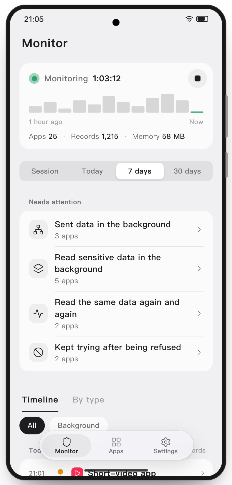
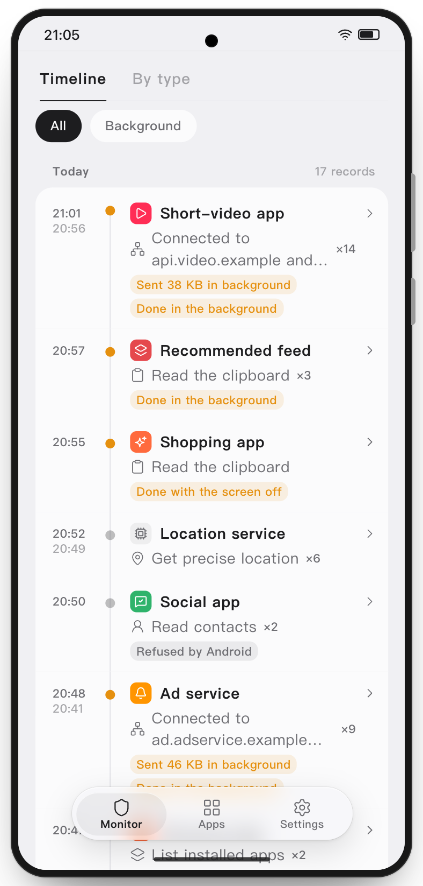
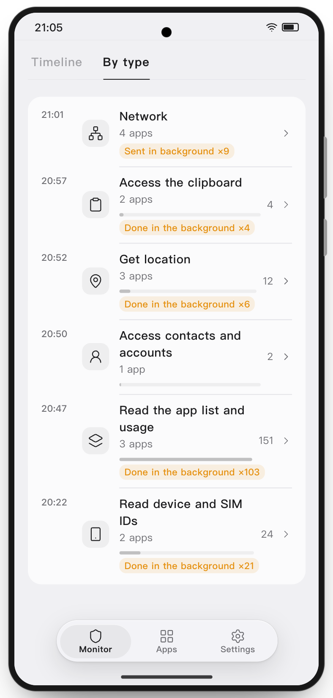
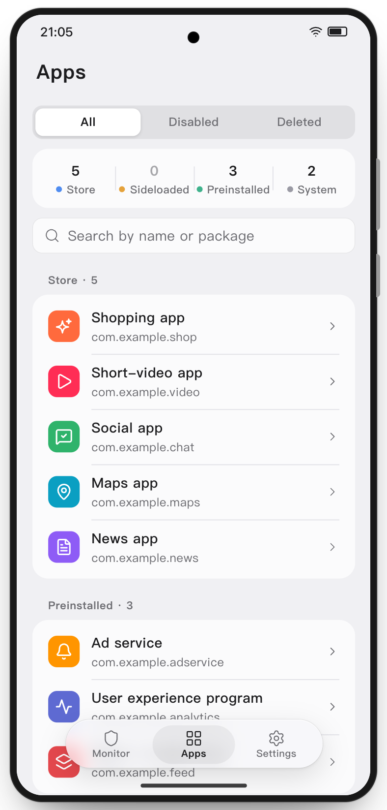
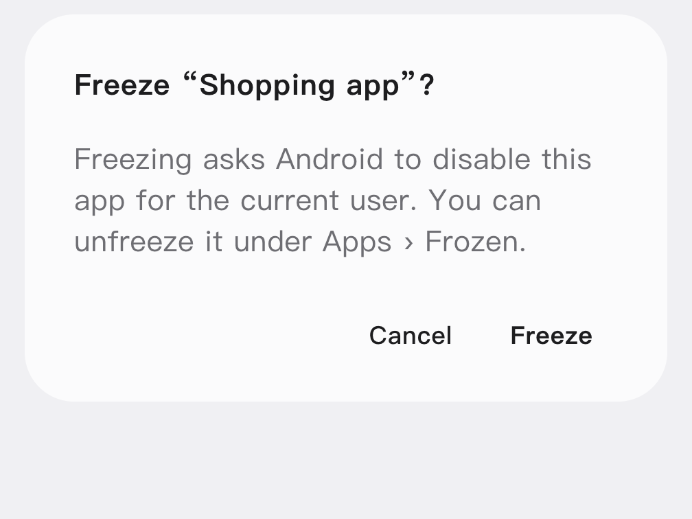
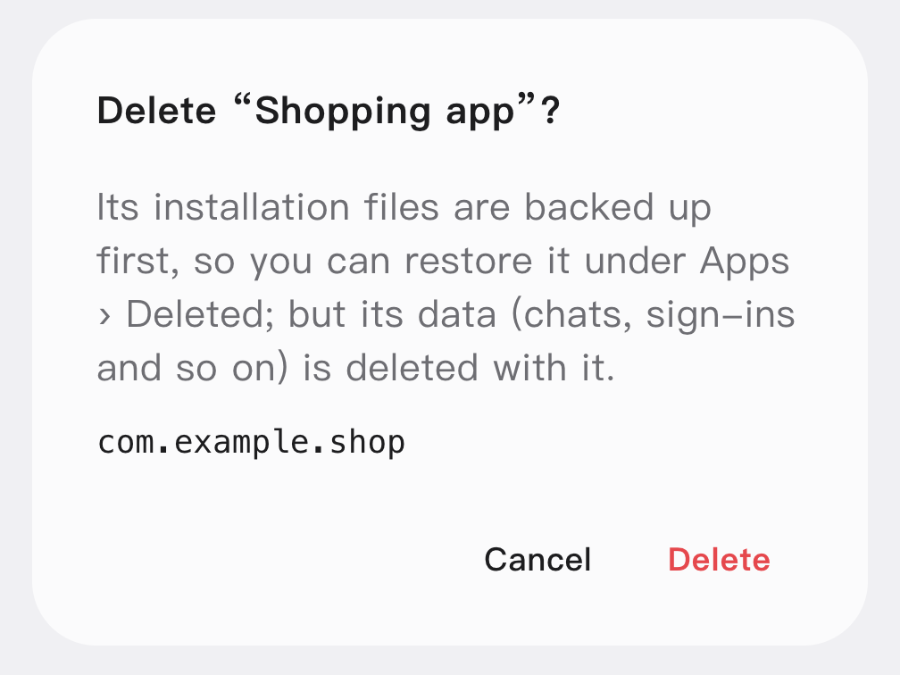
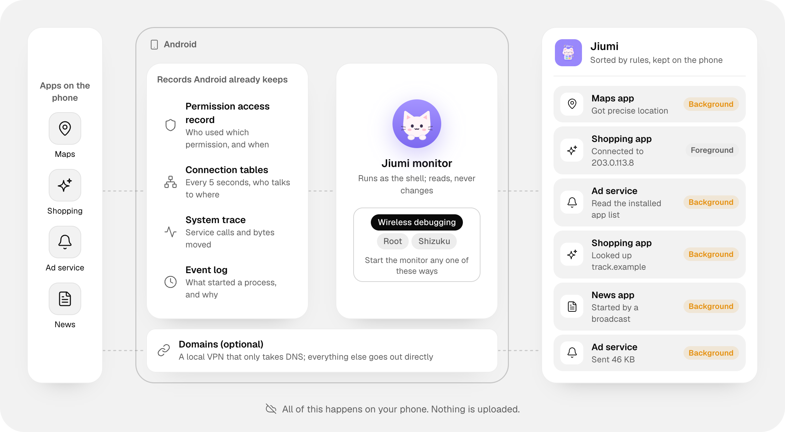

<div align="center">


# Jiumi 揪咪

軽量な Android アプリ行動モニター兼管理ツールです。
<br>Root もパソコンも不要で、記録はスマートフォン内に保存されます。

**[APK をダウンロード](https://github.com/ybblab/Jiumi/releases/latest)** · [ガイド](https://jiumi.ybblab.com/en/download/) · [ウェブサイト](https://jiumi.ybblab.com/en/) · [简体中文](README.md) · [English](README.en.md)

<sub>Android 11 以降 · APK 約 4 MB · <a href="LICENSE">Apache 2.0</a></sub>

</div>

## アプリの概要

<p align="center">
  <a href="code/images/monitor.en.png"></a>&nbsp;
  <a href="code/images/timeline.en.png"></a>&nbsp;
  <a href="code/images/by-type.en.png"></a>&nbsp;
  <a href="code/images/apps.en.png"></a>
</p>

## 機能

| 機能 | できること |
| --- | --- |
| アクティビティ記録 | 位置情報、クリップボード、デバイス識別子などを含む **12 グループ・56 種類のアクセス** を閲覧できます。記録は時間、アプリ、種類ごとに表示でき、バックグラウンドのアクティビティで絞り込むこともできます。 |
| 注意が必要 | バックグラウンドでのデータ送信、バックグラウンドでの機密データへのアクセス、頻繁なアクセス、繰り返し拒否された試行を確認できます。 |
| ネットワークアクティビティ | アプリごとに接続先アドレスと利用可能な通信量の測定値を確認できます。ドメイン記録を有効にすると、対応付けられた接続にドメインを表示できます。 |
| システム履歴 | アプリの詳細を開くと、Android が保持している権限アクセス記録と合計回数を確認できます。モニタリング開始前の一部のアクティビティも含まれます。 |
| ログのエクスポート | Settings › Export logs で、選択した期間の記録を CSV ファイルを含む ZIP として保存できます。 |
| 通知 | モニタリング中は、経過時間と停止ボタンを表示するコンパクトな通知が表示されます。Settings › Notifications でオフにできます。セッションのアプリ数と記録数を表示することもできます。Attention alerts をオンにすると、アプリで新たに注意が必要な項目が発生したときに通知されます。通知はセッション内でアプリと項目ごとに 1 回です。 |

## アプリの管理

アプリはインストール元ごとにまとめられています。アプリの詳細を開いてアクティビティを確認し、変更するかどうかを判断できます。アプリの管理操作はすべてユーザーが開始します。変更のたびに、Jiumi は Android から状態を読み戻して反映されたかを確認し、Android が拒否した場合はその理由を表示します。

<p align="center">
  <a href="code/images/app-disable.en.png"></a>&nbsp;
  <a href="code/images/app-delete.en.png"></a>&nbsp;
  <a href="code/images/app-restore.en.png"></a>
</p>

| 操作 | 内容 |
| --- | --- |
| 権限 | アプリの詳細の Permissions で、権限を 1 つずつオフまたはオンにできます。Manageable permissions を使うとすべてを一度にオフにでき、再びオンにすると Jiumi がオフにした権限だけが元に戻ります。システムがロックしている権限は読み取り専用として表示されます。 |
| ネットワークアクセス | 対応デバイスでは、VPN スロットを使わずに Android 標準のファイアウォールで個々のアプリのネットワークアクセスをブロックまたは復元できます。アプリが他のアプリと UID を共有している場合、ルールが別のツールによって設定されている場合、または Jiumi がこのアプリだけに影響することを確認できない場合は、スイッチが理由とともにロックされます。 |
| 凍結または凍結解除 | 凍結すると、Android が現在のユーザーに対してアプリを無効化し、データは保持されます。凍結解除は Apps › Frozen で行えます。凍結されたアプリには雪の結晶のバッジが付きます。 |
| 凍結の解除検出 | Jiumi が凍結したアプリが再び有効になっているのを検出すると、一覧と詳細で Freeze lifted と表示され、タイムラインに検出日時が記録されます。誰が有効にしたかはわかりません。Settings › App management › Freeze again when a freeze is lifted をオンにすると、Jiumi が再度凍結します。 |
| 自分でインストールしたアプリの削除 | 確認のため完全なパッケージ名を入力します。Jiumi はアンインストール前に APK をバックアップします。Apps › Deleted からアプリの再インストールを試みることができます。**アンインストールするとアプリのデータは削除されます。バックアップで復元できるのはインストールファイルだけです。** |
| プリインストールアプリの削除 | Settings › App management でオプションを有効にすると、対応するプリインストールアプリを現在のユーザーから削除できます。システム上のコピーとアプリのデータは保持され、Apps › Deleted からアプリの復元を試みることができます。削除されたアプリにはゴミ箱のバッジが付きます。 |

Settings › App management の Runs as には、これらの操作を誰が実行するかが表示されます。Root、または Root で起動した Shizuku を使う場合、凍結、凍結解除、現在のユーザーからの削除、復元は Root として実行されるため、スマートフォンが shell による変更を許可していないシステムアプリも Jiumi で変更できます。ワイヤレスデバッグを使う場合は shell として実行され、スマートフォンは一部のシステムアプリの変更を許可しません。その場合 Jiumi は理由を表示します。自分でインストールしたアプリのアンインストールは現在のユーザーにのみ影響するため、仕事用プロファイルやセカンドスペースにあるコピーは保持されます。

コアシステムコンポーネントはデフォルトで保護されています。スマートフォンが依存しているコンポーネントを変更すると、システム機能に影響する場合があります。Jiumi はそのような変更の前に警告を表示します。

## Jiumi は Root なしでどのようにバックグラウンドのアクティビティを把握するのですか？

Android は、アプリの実行に伴って権限アクセス記録、接続テーブル、システムトレース、イベントログを提供しています。Jiumi のモニターは、利用可能なシステムシグナルを **shell ユーザー** として読み取ります。アプリはそれらをルールに従って整理し、スマートフォン内のデータベースに保存します。モニタリングによって他のアプリにコードが注入されることはありません。凍結、削除、権限やネットワークアクセスのオフといった操作は、アプリの管理でユーザー自身が開始する必要があります。

<p align="center"></p>

| シグナル源 | Jiumi が把握できること |
| --- | --- |
| 権限アクセス記録 (AppOps) | どのアプリがいつ権限を使用したか、および Android が保持している履歴。 |
| 接続テーブル | アプリがどのアドレスに接続したか。デフォルトでは 5 秒ごとにサンプリングされます。 |
| システムトレース (Perfetto) | 識別可能なシステムサービスの呼び出しと、システムが対応している場合は接続ごとの通信量。 |
| イベントログ | プロセスがいつ起動したか、および Android が記録した理由。 |

**ワイヤレスデバッグ、Shizuku、Root から選択できます。** いずれの場合もモニターは shell ユーザーとして実行されます。ワイヤレスデバッグはスマートフォン単体でペアリングできます。Shizuku は ADB または Root で起動でき、Jiumi への権限付与が必要です。Root オプションでは shell ユーザーに切り替えてモニターを起動します。加えて、アプリの凍結、凍結解除、現在のユーザーからの削除、復元は直接 Root として実行されるため、Android が shell による変更を許可していないアプリも Jiumi で変更できます。Root で起動した Shizuku でも同様です。

**オプションのドメイン記録** は、ローカル VPN を使って DNS クエリを受け取り、現在のネットワークの DNS サーバーへそのまま転送します。その他の通信は宛先へ直接送られます。ドメイン記録はシステムの VPN スロットを占有します。また、アプリ独自の暗号化 DNS や、ホスト名を指定したプライベート DNS プロバイダを使うクエリは、ドメイン記録を経由しない場合があります。

## ダウンロードしてモニタリングを開始する

1. Android 11 以降のスマートフォンで、[GitHub Releases](https://github.com/ybblab/Jiumi/releases/latest) から APK をダウンロードしてインストールします。
2. Jiumi を初めて開いたときに起動方法を選択します。推奨されるワイヤレスデバッグの場合は、Wi-Fi に接続し、セットアップに従って通知を許可し、開発者向けオプションをオンにして、Jiumi の通知にシステムの 6 桁のペアリングコードを入力します。
3. Monitor ページで Start monitoring をタップします。モニタリング中は常駐通知が表示されます。モニタリングは通知またはアプリから停止できます。

スマートフォンの再起動、Jiumi のアップデート、デバッグサービスの中断のあと、選択した接続が利用可能になると、Jiumi は同じセッションを自動的に再開します。カードに Monitoring interrupted と表示された場合は、選択した接続を復旧してから Resume をタップします。中断していた時間はモニタリング時間に含まれません。

ワイヤレスデバッグを使用する場合、USB デバッグも併せてオンにしておくと、Wi-Fi の切断時に Android がワイヤレスデバッグをオフにしても、実行中のモニターを維持しやすくなります。ADB の永続化はデフォルトでオフで、デバイスが検証済みのループバックリスナーをすでに提供している場合にのみポートを再利用します。詳しくは [セットアップガイド](https://jiumi.ybblab.com/en/download/) をご覧ください。

## プライバシーと制限事項

- **記録はスマートフォン内に保存されます。** Jiumi にはアカウントがなく、モニタリングの記録をアップロードしません。アプリは GitHub でアップデートを確認できます。アップデートを選択すると APK をダウンロードし、そのサイズ、SHA-256、署名を検証します。アップデートの確認はオフにできます。
- **記録が示すのはアクティビティと接続です。** Jiumi は権限が使用されたことやアクセスが拒否されたことを表示できます。メッセージ、パスワード、ネットワーク通信の内容は見ることができません。
- **把握できる範囲はシステムに依存します。** 短い接続はサンプリングの合間に終了することがあり、ファイルの直接読み取りなどの操作では利用可能なシグナルが生じない場合があります。接続ごとの通信量には Android 14 以降とシステムの対応が必要です。Jiumi は誤報を減らすため、確認できない一部のアクティビティを除外します。
- **モニタリングは追加のバッテリーを消費します。** 消費量はアプリのアクティビティによって異なります。不要になったら通知からモニタリングを停止してください。

## ソースからビルドする

JDK 17 と Android SDK が必要です。

```sh
cd code
./gradlew :app:assembleDebug
```

モニタリングのカテゴリ、注意ルール、保護対象のアプリは [rules ディレクトリ](code/app/src/main/assets/rules/) で設定されています。コードの構成と貢献の手順については [CONTRIBUTING.md](CONTRIBUTING.md) をご覧ください。

## 貢献とライセンス

Issue と Pull Request を歓迎します。セキュリティ上の問題は [SECURITY.md](SECURITY.md) に記載された方法で非公開で報告してください。

Jiumi は [Apache License 2.0](LICENSE) のもとでライセンスされています。サードパーティのコンポーネントとそのライセンスは [NOTICE](NOTICE) に記載されています。Jiumi は、所有しているデバイスまたは使用を許可されているデバイスでご使用ください。

## スター履歴

<a href="https://www.star-history.com/#ybblab/Jiumi&amp;Date">
  <picture>
    <source media="(prefers-color-scheme: dark)" srcset="https://api.star-history.com/svg?repos=ybblab/Jiumi&amp;type=Date&amp;theme=dark" />
    
  </picture>
</a>

<div align="center">

**Jiumi がアプリの動作を把握するのに役立ったら、GitHub で ⭐ をお願いします！**

</div>
