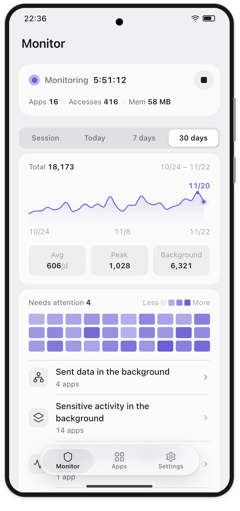
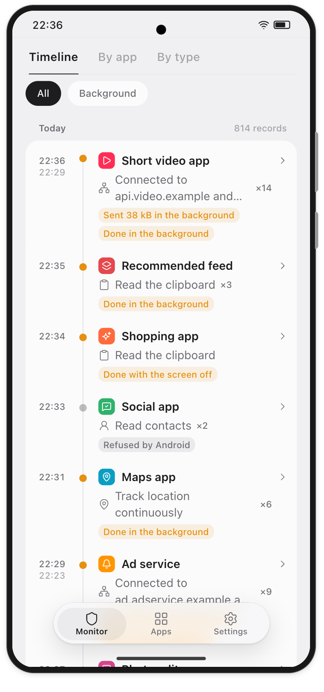
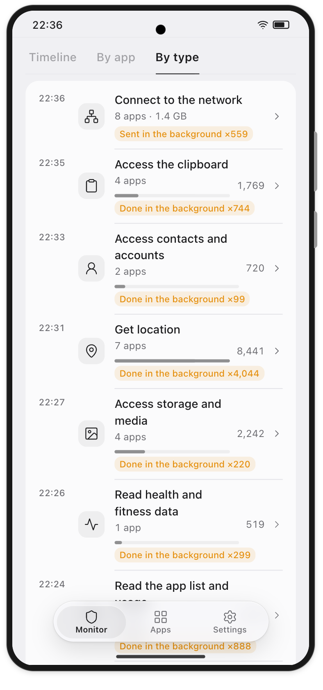
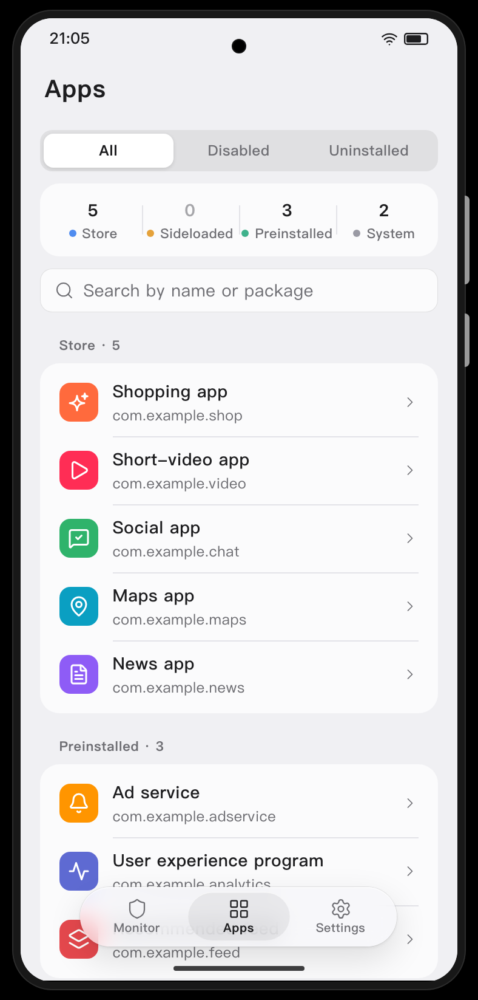
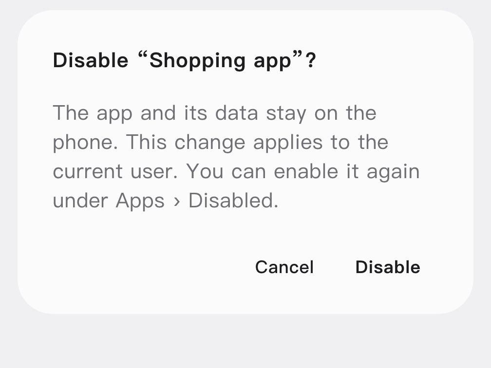
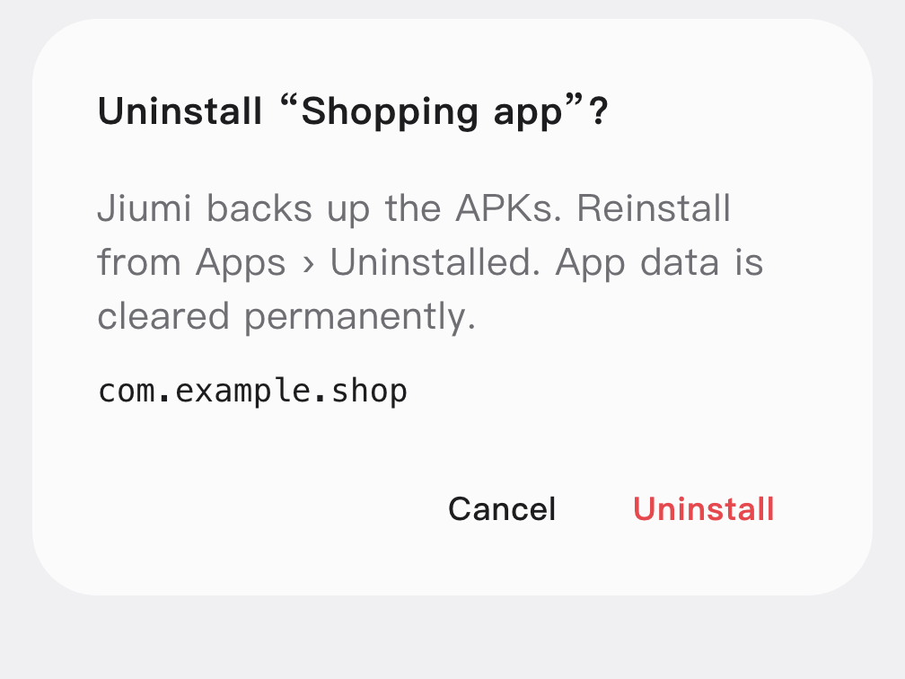
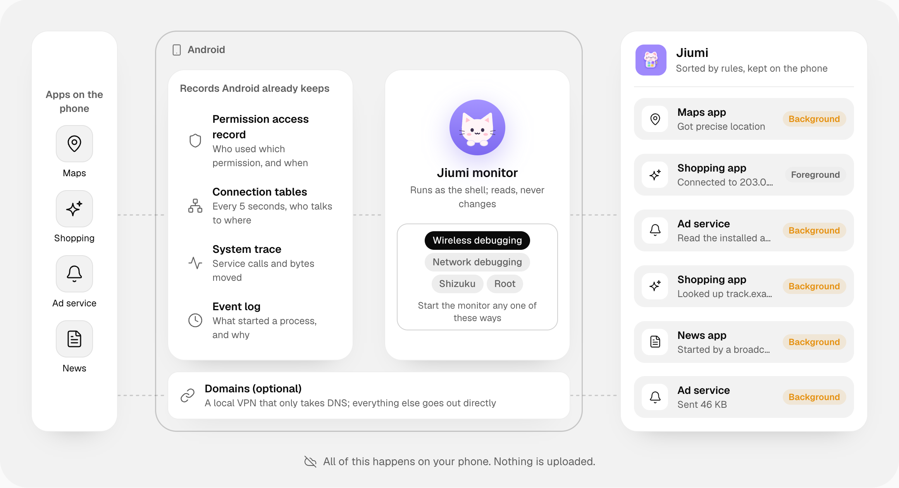

<div align="center">


# Jiumi 揪咪

Android ऐप की गतिविधियों पर नज़र रखने और ऐप प्रबंधित करने का एक हल्का टूल।
<br>इसके लिए रूट एक्सेस या कंप्यूटर की ज़रूरत नहीं है। रिकॉर्ड आपके फ़ोन पर ही रहते हैं।

**[APK डाउनलोड करें](https://github.com/ybblab/Jiumi/releases/latest)** · [उपयोग मार्गदर्शिका](https://jiumi.ybblab.com/en/download/) · [आधिकारिक वेबसाइट](https://jiumi.ybblab.com/en/)

<sub>Android 11 या बाद का संस्करण · APK लगभग 4 MB · <a href="../../LICENSE">Apache 2.0</a></sub>

[简体中文](../../README.md) · [English](README.en.md) · [日本語](README.ja.md) · [한국어](README.ko.md) · [Español](README.es.md) · [Deutsch](README.de.md) · [Français](README.fr.md) · **हिन्दी** · [Bahasa Indonesia](README.id.md) · [Português (Brasil)](README.pt-BR.md) · [Русский](README.ru.md)

</div>

## ऐप की एक झलक

<p align="center">
  <a href="../images/monitor.en.png"></a>&nbsp;
  <a href="../images/timeline.en.png"></a>&nbsp;
  <a href="../images/by-type.en.png"></a>&nbsp;
  <a href="../images/apps.en.png"></a>
</p>

## सुविधाएँ

| सुविधा | आप क्या कर सकते हैं |
| --- | --- |
| गतिविधि रिकॉर्ड | लोकेशन, क्लिपबोर्ड और डिवाइस पहचानकर्ताओं समेत **12 समूहों में 56 तरह के एक्सेस** देखें। रिकॉर्ड को समय, ऐप या प्रकार के अनुसार देखें और बैकग्राउंड गतिविधियों के लिए फ़िल्टर लगाएँ। |
| ध्यान देने योग्य गतिविधियाँ | बैकग्राउंड में डेटा भेजने और संवेदनशील डेटा तक पहुँचने की गतिविधियाँ देखें। बार-बार एक्सेस करने और बार-बार अस्वीकार हुए प्रयासों की भी समीक्षा करें। |
| नेटवर्क गतिविधि | हर ऐप के कनेक्शन पते और उपलब्ध ट्रैफ़िक आँकड़े देखें। डोमेन रिकॉर्डिंग चालू होने पर, जिन कनेक्शन का डोमेन पता चल सके, उनके साथ वह दिख सकता है। |
| सिस्टम का इतिहास | किसी ऐप के विवरण में वे अनुमति-उपयोग रिकॉर्ड और उनकी कुल संख्या देखें जिन्हें Android रखता है। इसमें निगरानी शुरू होने से पहले की कुछ गतिविधियाँ भी शामिल हैं। |
| रिकॉर्ड एक्सपोर्ट करना | **Settings › Export logs** में चुनी गई अवधि के रिकॉर्ड CSV फ़ाइलों वाले ZIP में सहेजें। |
| सूचनाएँ | निगरानी के दौरान एक छोटी सूचना बीता हुआ समय और रोकने का बटन दिखाती है। इसे **Settings › Notifications** में बंद किया जा सकता है। इसमें सत्र के ऐप और रिकॉर्ड की संख्या भी दिखाई जा सकती है। **Attention alerts** चालू करने पर, किसी ऐप में ध्यान देने योग्य नई गतिविधि मिलने पर सूचना मिलती है। एक सत्र में हर ऐप और गतिविधि के उस प्रकार के लिए एक बार सूचना मिलती है। |

## ऐप प्रबंधित करें

ऐप को उनके इंस्टॉलेशन के स्रोत के अनुसार समूहों में दिखाया जाता है। किसी ऐप का विवरण खोलकर उसकी गतिविधि देखें और तय करें कि कोई बदलाव करना है या नहीं। प्रबंधन की कार्रवाइयाँ आप शुरू करते हैं। हर बदलाव के बाद Jiumi Android से स्थिति दोबारा पढ़कर पुष्टि करता है कि बदलाव लागू हुआ। Android के मना करने पर Jiumi वजह बताता है।

<p align="center">
  <a href="../images/app-disable.en.png"></a>&nbsp;
  <a href="../images/app-delete.en.png"></a>&nbsp;
  <a href="../images/app-restore.en.png"></a>
</p>

| कार्रवाई | क्या होता है |
| --- | --- |
| अनुमतियाँ | ऐप के विवरण में **Permissions** के तहत अनुमतियाँ एक-एक करके चालू या बंद करें। **Manageable permissions** से प्रबंधित की जा सकने वाली सभी अनुमतियाँ एक साथ बंद होती हैं। दोबारा चालू करने पर केवल वे अनुमतियाँ बहाल होती हैं जिन्हें Jiumi ने बंद किया था। सिस्टम ने जिन अनुमतियों को लॉक किया है, उन्हें सिर्फ़ देखा जा सकता है। |
| नेटवर्क एक्सेस | समर्थित डिवाइस पर Android के अपने फ़ायरवॉल से एक ऐप का नेटवर्क एक्सेस रोकें या बहाल करें। इसके लिए VPN स्लॉट का उपयोग नहीं होता। अगर ऐप दूसरे ऐप के साथ UID साझा करता है, नियम किसी दूसरे टूल ने बनाया है या Jiumi पुष्टि नहीं कर पाता कि सिर्फ़ इसी ऐप पर असर होगा, तो स्विच लॉक रहता है और वजह दिखाई जाती है। |
| ऐप निष्क्रिय या सक्रिय करें | Android ऐप को मौजूदा उपयोगकर्ता के लिए निष्क्रिय करता है। ऐप और उसका डेटा सुरक्षित रहते हैं। **Apps › Disabled** में उसे फिर से सक्रिय कर सकते हैं। निष्क्रिय ऐप पर बर्फ़ के फाहे का निशान दिखता है। |
| फिर से सक्रिय | अगर Jiumi को पता चलता है कि उसके द्वारा निष्क्रिय किया गया ऐप फिर से सक्रिय है, तो सूची और विवरण में **Re-enabled** दिखता है। समयरेखा में पता चलने का समय दर्ज होता है। **Settings › App management › Disable again when re-enabled** चालू करने पर Jiumi ऐप को फिर से निष्क्रिय कर देता है। |
| अपने इंस्टॉल किए ऐप को अनइंस्टॉल करें | पुष्टि के लिए पैकेज का पूरा नाम डालें। Jiumi मुख्य APK और मौजूद स्प्लिट APK का बैकअप लेता है। **Apps › Uninstalled** से ऐप को दोबारा इंस्टॉल करने की कोशिश कर सकते हैं। **अनइंस्टॉल करने से ऐप का डेटा मिट जाता है। बैकअप में केवल इंस्टॉलेशन फ़ाइलें होती हैं।** |
| पहले से इंस्टॉल ऐप को अनइंस्टॉल करें | समर्थित ऐप को मौजूदा उपयोगकर्ता के लिए अनइंस्टॉल करने के लिए **Settings › App management** में **Allow uninstalling preinstalled apps** चालू करें। फ़ोन में मौजूद मूल कॉपी और ऐप का डेटा सुरक्षित रहते हैं। **Apps › Uninstalled** से ऐप बहाल करने की कोशिश कर सकते हैं। अनइंस्टॉल किए गए ऐप पर कूड़ेदान का निशान दिखता है। |

**Settings › App management** में **Runs as** बताता है कि कार्रवाई किस उपयोगकर्ता के रूप में होती है। रूट एक्सेस या रूट के रूप में शुरू किए गए Shizuku के साथ ऐप निष्क्रिय और सक्रिय करना तथा पहले से इंस्टॉल ऐप को अनइंस्टॉल और बहाल करना रूट के रूप में होता है। इससे Jiumi उन सिस्टम ऐप में भी बदलाव कर सकता है जिन्हें डिवाइस shell उपयोगकर्ता को बदलने नहीं देता। वायरलेस डीबगिंग में ये कार्रवाइयाँ shell उपयोगकर्ता के रूप में होती हैं। जिन सिस्टम ऐप में डिवाइस बदलाव करने नहीं देता, उनके लिए Jiumi वजह दिखाता है। अपने इंस्टॉल किए ऐप को अनइंस्टॉल करने का असर केवल मौजूदा उपयोगकर्ता पर होता है। वर्क प्रोफ़ाइल या दूसरे स्पेस में उसकी कॉपी बनी रहती है।

सिस्टम के ज़रूरी घटक डिफ़ॉल्ट रूप से सुरक्षित होते हैं। किसी ऐसे घटक को बदलने से जिस पर फ़ोन निर्भर है, सिस्टम की सुविधाओं पर असर पड़ सकता है। Jiumi ऐसे बदलाव से पहले चेतावनी दिखाता है।

## Jiumi रूट एक्सेस के बिना बैकग्राउंड गतिविधि कैसे देखता है?

ऐप चलने पर Android अनुमति-उपयोग रिकॉर्ड, कनेक्शन टेबल, सिस्टम ट्रेस और इवेंट लॉग उपलब्ध कराता है। Jiumi का मॉनिटर उपलब्ध सिस्टम संकेतों को **shell उपयोगकर्ता** के रूप में पढ़ता है। ऐप उन्हें नियमों के अनुसार व्यवस्थित करता है और फ़ोन पर डेटाबेस में रखता है। निगरानी के दौरान दूसरे ऐप में कोड इंजेक्ट नहीं होता। ऐप निष्क्रिय या अनइंस्टॉल करने, अनुमतियाँ बंद करने या नेटवर्क एक्सेस रोकने के लिए आपको ऐप प्रबंधन में खुद कार्रवाई शुरू करनी होती है।

<p align="center"></p>

| संकेत का स्रोत | Jiumi क्या देख सकता है |
| --- | --- |
| अनुमति-उपयोग रिकॉर्ड (AppOps) | किस ऐप ने कब किसी अनुमति का इस्तेमाल किया, साथ में Android का रखा हुआ इतिहास। |
| कनेक्शन टेबल | ऐप किन पतों से जुड़े। डिफ़ॉल्ट रूप से हर पाँच सेकंड में एक सैंपल लिया जाता है। |
| सिस्टम ट्रेस (Perfetto) | पहचाने जा सकने वाले सिस्टम सेवा कॉल और, जहाँ सिस्टम इसका समर्थन करता है, हर कनेक्शन का ट्रैफ़िक। |
| इवेंट लॉग | कोई प्रोसेस कब शुरू हुआ और Android ने उसकी क्या वजह दर्ज की। |

**वायरलेस डीबगिंग, Shizuku या रूट में से चुनें।** तीनों तरीकों में मॉनिटर shell उपयोगकर्ता के रूप में चलता है। वायरलेस डीबगिंग की पेयरिंग फ़ोन पर ही हो सकती है। Shizuku को ADB या रूट से शुरू किया जा सकता है और इसके इस्तेमाल के लिए Jiumi को अनुमति देनी होती है। रूट वाला विकल्प मॉनिटर शुरू करने के लिए shell उपयोगकर्ता पर स्विच करता है। ऐप निष्क्रिय और सक्रिय करना तथा पहले से इंस्टॉल ऐप को अनइंस्टॉल और बहाल करना सीधे रूट के रूप में होता है। इससे Jiumi उन ऐप में भी बदलाव कर सकता है जिन्हें Android shell उपयोगकर्ता को बदलने नहीं देता। रूट से शुरू किए गए Shizuku में भी यही लागू होता है।

**वैकल्पिक डोमेन रिकॉर्डिंग** स्थानीय VPN से DNS क्वेरी लेती है और बिना बदले उन्हें मौजूदा नेटवर्क के DNS सर्वर पर भेजती है। बाकी ट्रैफ़िक सीधे अपने गंतव्य पर जाता है। डोमेन रिकॉर्डिंग सिस्टम का VPN स्लॉट इस्तेमाल करती है। ऐप के अपने एन्क्रिप्ट किए गए DNS या होस्टनाम से सेट किए गए निजी DNS प्रदाता की क्वेरी रिकॉर्डिंग से बाहर रह सकती हैं।

## डाउनलोड करें और निगरानी शुरू करें

1. Android 11 या बाद के संस्करण वाले फ़ोन पर [GitHub Releases](https://github.com/ybblab/Jiumi/releases/latest) से APK डाउनलोड करके इंस्टॉल करें।
2. Jiumi को पहली बार खोलने पर शुरू करने का तरीका चुनें। सुझाए गए तरीके, वायरलेस डीबगिंग, के लिए Wi-Fi से जुड़ें और सेटअप के निर्देशों के अनुसार सूचनाओं की अनुमति दें और डेवलपर विकल्प चालू करें। सिस्टम में दिखने वाला छह अंकों का पेयरिंग कोड Jiumi की सूचना में डालें।
3. **Monitor** स्क्रीन पर **Start monitoring** दबाएँ। निगरानी चालू रहने तक एक सूचना बनी रहती है। निगरानी सूचना या ऐप से रोकी जा सकती है।

फ़ोन के रीस्टार्ट, Jiumi के अपडेट या डीबगिंग सेवा में रुकावट के बाद, चुना हुआ कनेक्शन उपलब्ध होते ही Jiumi उसी सत्र को अपने आप जारी रखता है। अगर कार्ड में **Monitoring interrupted** दिखे, तो चुना हुआ कनेक्शन बहाल करें और **Resume** दबाएँ। रुकावट की अवधि निगरानी की अवधि में नहीं जुड़ती।

वायरलेस डीबगिंग के साथ USB डीबगिंग भी चालू रखने से मॉनिटर चलता रह सकता है, अगर Wi-Fi कटने पर Android वायरलेस डीबगिंग बंद कर दे। ADB कनेक्शन बनाए रखने का विकल्प डिफ़ॉल्ट रूप से बंद है। इसे चालू करने पर भी पोर्ट दोबारा तभी इस्तेमाल होता है, जब डिवाइस पर पहले से सत्यापित लोकल लूपबैक लिसनर मौजूद हो। ज़्यादा जानकारी के लिए [सेटअप मार्गदर्शिका](https://jiumi.ybblab.com/en/download/) देखें।

## निजता और सीमाएँ

- **रिकॉर्ड आपके फ़ोन पर ही रहते हैं।** Jiumi में खाता नहीं बनाया जाता और निगरानी रिकॉर्ड अपलोड नहीं होते। ऐप GitHub पर अपडेट देख सकता है। अपडेट चुनने पर ऐप APK डाउनलोड करके उसका आकार, SHA-256 हैश और हस्ताक्षर जाँचता है। अपडेट की जाँच बंद की जा सकती है।
- **रिकॉर्ड में गतिविधियों और कनेक्शन की जानकारी होती है।** Jiumi दिखा सकता है कि किसी अनुमति का उपयोग हुआ या एक्सेस अस्वीकार हुआ। यह संदेश, पासवर्ड या नेटवर्क ट्रैफ़िक की सामग्री नहीं देख सकता।
- **क्या दिखेगा, यह सिस्टम पर निर्भर है।** छोटे कनेक्शन दो सैंपल के बीच समाप्त हो सकते हैं। सीधे फ़ाइल पढ़ने जैसी गतिविधियाँ कोई उपयोगी संकेत नहीं छोड़ सकतीं। हर कनेक्शन का ट्रैफ़िक मापने के लिए Android 14 या बाद का संस्करण और सिस्टम का समर्थन ज़रूरी है। ग़लत रिपोर्ट कम करने के लिए Jiumi कुछ ऐसी गतिविधियाँ छोड़ देता है जिनकी वह पुष्टि नहीं कर सकता।
- **निगरानी में ज़्यादा बैटरी लगती है।** खपत ऐप की गतिविधि पर निर्भर करती है। ज़रूरत न रहने पर सूचना से निगरानी रोक दें।

## सोर्स कोड से बिल्ड करें

JDK 17 और Android SDK की ज़रूरत है।

```sh
cd code
./gradlew :app:assembleDebug
```

निगरानी की श्रेणियाँ, अलर्ट के नियम और सुरक्षित ऐप की सेटिंग [rules डायरेक्टरी](../../code/app/src/main/assets/rules/) में हैं। कोड की संरचना और योगदान का तरीका [CONTRIBUTING.md](../../CONTRIBUTING.md) में देखें।

## योगदान और लाइसेंस

समस्याओं की रिपोर्ट और पुल रिक्वेस्ट का स्वागत है। सुरक्षा समस्याओं की निजी तौर पर रिपोर्ट करने के लिए [SECURITY.md](../../SECURITY.md) में दिए निर्देशों का पालन करें।

Jiumi [Apache License 2.0](../../LICENSE) के तहत उपलब्ध है। दूसरे पक्षों के घटक और उनके लाइसेंस [NOTICE](../../NOTICE) में दर्ज हैं। Jiumi का इस्तेमाल ऐसे डिवाइस पर करें जो आपका है या जिसका इस्तेमाल करने की आपको अनुमति है।

## GitHub स्टार का इतिहास

<a href="https://www.star-history.com/#ybblab/Jiumi&amp;Date">
  <picture>
    <source media="(prefers-color-scheme: dark)" srcset="https://api.star-history.com/svg?repos=ybblab/Jiumi&amp;type=Date&amp;theme=dark" />
    
  </picture>
</a>

<div align="center">

**अगर Jiumi से आपको समझने में मदद मिलती है कि आपके ऐप क्या करते हैं, तो GitHub पर इसे ⭐ दें।**

</div>
