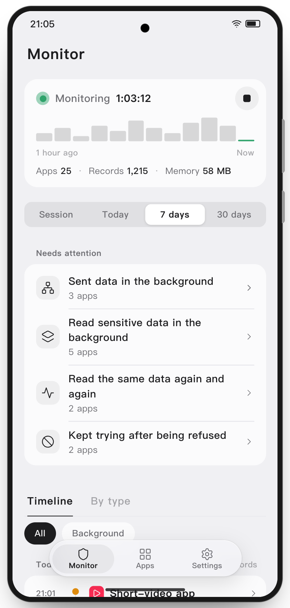
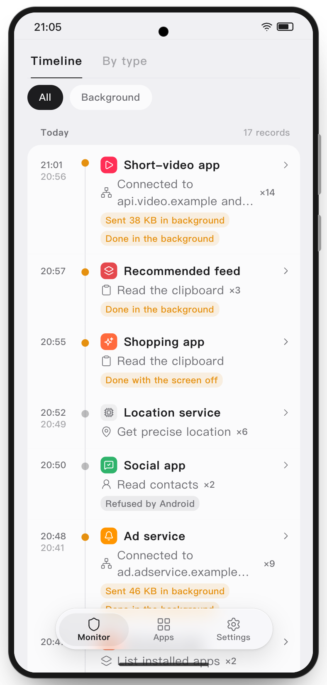
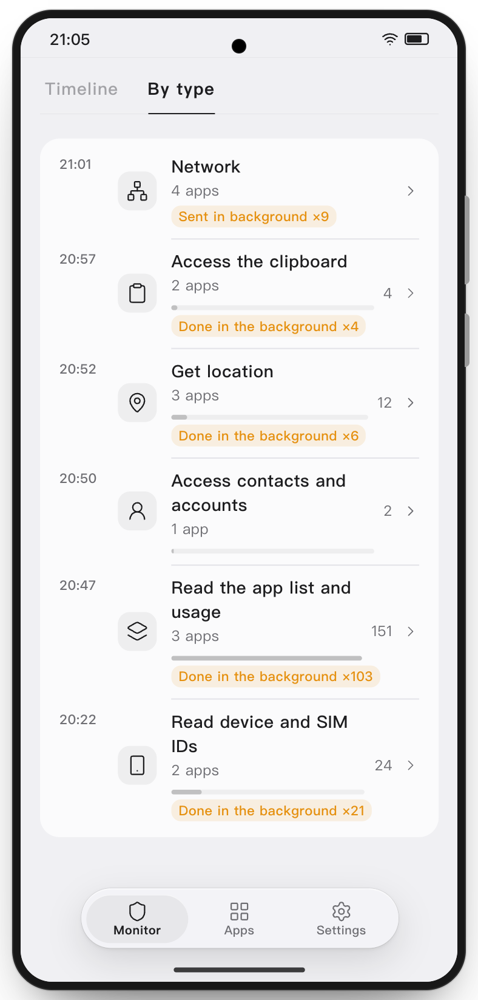
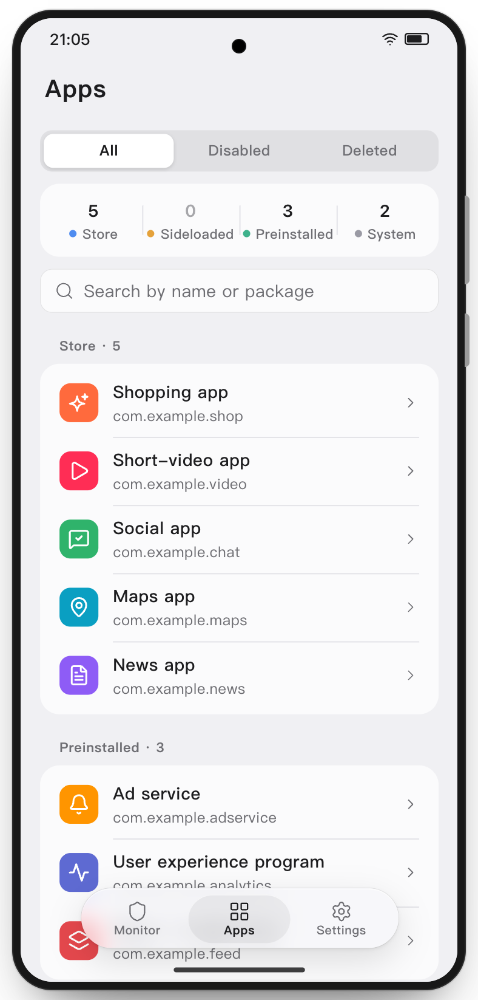
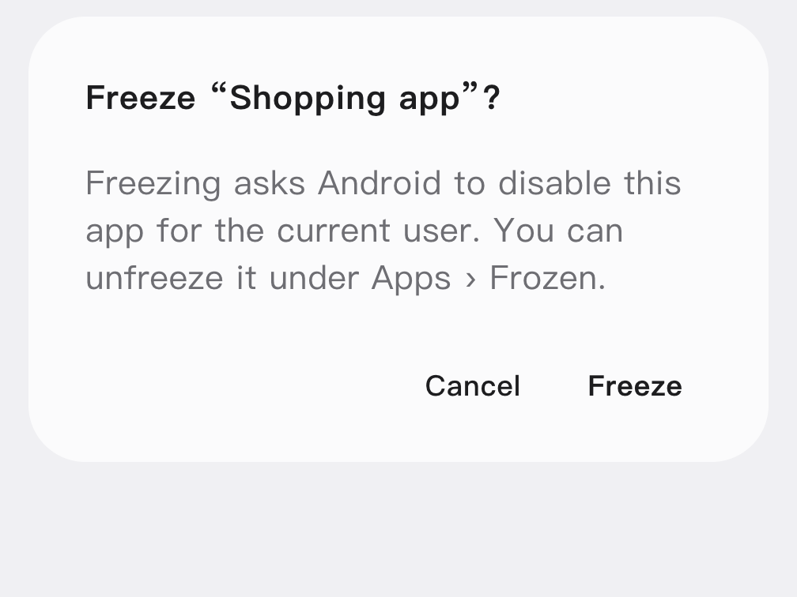
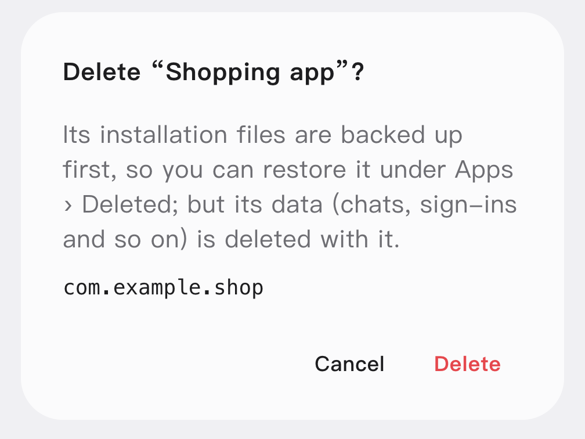
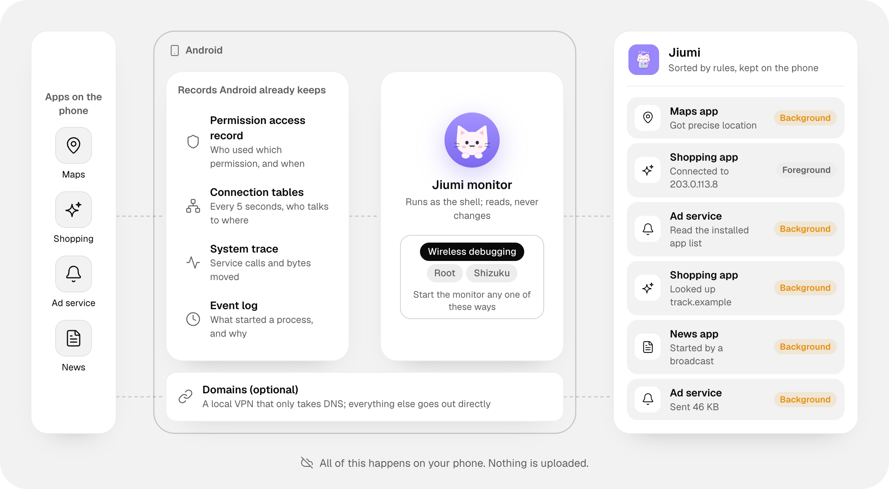

<div align="center">


# Jiumi 揪咪

Alat ringan untuk memantau aktivitas dan mengelola aplikasi Android.
<br>Tidak memerlukan akses root atau komputer. Catatan tetap tersimpan di ponsel.

**[Unduh APK](https://github.com/ybblab/Jiumi/releases/latest)** · [Panduan](https://jiumi.ybblab.com/en/download/) · [Situs resmi](https://jiumi.ybblab.com/en/)

<sub>Android 11 atau lebih baru · APK sekitar 4 MB · <a href="../../LICENSE">Apache 2.0</a></sub>

[简体中文](../../README.md) · [English](README.en.md) · [日本語](README.ja.md) · [한국어](README.ko.md) · [Español](README.es.md) · [Deutsch](README.de.md) · [Français](README.fr.md) · [हिन्दी](README.hi.md) · **Bahasa Indonesia** · [Português (Brasil)](README.pt-BR.md) · [Русский](README.ru.md)

</div>

## Sekilas tentang aplikasi

<p align="center">
  <a href="../images/monitor.en.png"></a>&nbsp;
  <a href="../images/timeline.en.png"></a>&nbsp;
  <a href="../images/by-type.en.png"></a>&nbsp;
  <a href="../images/apps.en.png"></a>
</p>

## Fitur

| Fitur | Yang dapat Anda lakukan |
| --- | --- |
| Catatan aktivitas | Lihat **56 jenis akses dalam 12 kelompok**, termasuk lokasi, papan klip, dan pengenal perangkat. Lihat catatan berdasarkan waktu, aplikasi, atau jenis, serta saring aktivitas latar belakang. |
| Perlu perhatian | Tinjau transfer data dan akses data sensitif di latar belakang, akses yang sering terjadi, serta percobaan akses yang berulang kali ditolak. |
| Aktivitas jaringan | Lihat alamat koneksi dan pengukuran lalu lintas yang tersedia untuk tiap aplikasi. Jika pencatatan domain diaktifkan, koneksi yang berhasil dicocokkan dapat menampilkan nama domain. |
| Riwayat sistem | Buka detail aplikasi untuk melihat catatan dan jumlah akses izin yang disimpan Android, termasuk sebagian aktivitas sebelum pemantauan dimulai. |
| Ekspor catatan | Di **Settings › Export logs**, simpan catatan dari rentang waktu yang dipilih sebagai arsip ZIP berisi berkas CSV. |
| Notifikasi | Selama pemantauan, notifikasi ringkas menampilkan durasi dan tombol berhenti. Notifikasi ini dapat dimatikan di **Settings › Notifications**. Notifikasi juga dapat menampilkan jumlah aplikasi dan catatan dalam sesi. Jika **Attention alerts** diaktifkan, Anda mendapat notifikasi ketika muncul aktivitas baru yang perlu diperhatikan, sekali per aplikasi dan jenis peringatan dalam satu sesi. |

## Mengelola aplikasi

Aplikasi dikelompokkan menurut sumber pemasangan. Buka detail aplikasi untuk meninjau aktivitasnya dan memutuskan apakah perlu melakukan perubahan. Anda yang memulai tindakan pengelolaan. Setelah setiap perubahan, Jiumi membaca kembali status dari Android untuk memastikan perubahan diterapkan. Jika Android menolak, Jiumi menampilkan alasannya.

<p align="center">
  <a href="../images/app-disable.en.png"></a>&nbsp;
  <a href="../images/app-delete.en.png"></a>&nbsp;
  <a href="../images/app-restore.en.png"></a>
</p>

| Tindakan | Hasil |
| --- | --- |
| Izin | Aktifkan atau nonaktifkan izin satu per satu di **Permissions** pada detail aplikasi. **Manageable permissions** menonaktifkan semua izin yang dapat dikelola sekaligus. Saat sakelar dinyalakan kembali, hanya izin yang telah dinonaktifkan oleh Jiumi yang dipulihkan. Izin yang dikunci sistem ditampilkan sebagai hanya baca. |
| Akses jaringan | Pada perangkat yang didukung, blokir atau pulihkan akses jaringan satu aplikasi dengan firewall bawaan Android tanpa menggunakan slot VPN. Sakelar dikunci dan alasannya ditampilkan jika aplikasi berbagi UID dengan aplikasi lain, aturan dibuat oleh alat lain, atau Jiumi tidak dapat memastikan bahwa hanya aplikasi tersebut yang terdampak. |
| Bekukan atau batalkan pembekuan | Saat dibekukan, aplikasi dinonaktifkan oleh Android untuk pengguna saat ini dan datanya tetap disimpan. Batalkan pembekuan di **Apps › Frozen**. Aplikasi yang dibekukan ditandai ikon kepingan salju. |
| Pembekuan dicabut | Jika aplikasi yang dibekukan oleh Jiumi ditemukan aktif kembali, status **Freeze lifted** muncul di daftar dan detail aplikasi. Linimasa mencatat waktu terdeteksinya perubahan. Tidak diketahui siapa yang mengaktifkannya kembali. Jika **Settings › App management › Freeze again when a freeze is lifted** diaktifkan, Jiumi akan membekukannya lagi. |
| Hapus aplikasi yang Anda pasang | Masukkan nama paket lengkap untuk konfirmasi. Sebelum mencopot aplikasi, Jiumi mencadangkan APK utama beserta APK terpisahnya jika ada. Anda dapat mencoba memasang ulang aplikasi dari **Apps › Deleted**. **Mencopot aplikasi menghapus datanya. Cadangan hanya dapat memulihkan berkas pemasangan.** |
| Hapus aplikasi bawaan | Aktifkan opsi di **Settings › App management** untuk menghapus aplikasi bawaan yang didukung bagi pengguna saat ini. Salinan di sistem dan data aplikasi tetap disimpan. Anda dapat mencoba memulihkan aplikasi dari **Apps › Deleted**. Aplikasi yang dihapus ditandai ikon tempat sampah. |

Di **Settings › App management**, **Runs as** menunjukkan identitas pengguna yang menjalankan tindakan. Dengan akses root atau Shizuku yang dijalankan sebagai root, tindakan membekukan, membatalkan pembekuan, menghapus untuk pengguna saat ini, dan memulihkan dijalankan sebagai root. Dengan begitu, Jiumi bisa mengubah aplikasi sistem yang tidak dapat diubah oleh pengguna shell. Dengan proses debug nirkabel, tindakan tersebut dijalankan sebagai pengguna shell. Jika ponsel memblokir perubahan pada aplikasi sistem tertentu, Jiumi menampilkan alasannya. Mencopot aplikasi yang Anda pasang hanya memengaruhi pengguna saat ini. Salinan di profil kerja atau ruang kedua tetap terpasang.

Komponen inti sistem dilindungi secara bawaan. Mengubah komponen yang dibutuhkan ponsel dapat memengaruhi fungsi sistem. Jiumi menampilkan peringatan sebelum melakukan perubahan tersebut.

## Bagaimana Jiumi melihat aktivitas latar belakang tanpa root?

Saat aplikasi berjalan, Android menyediakan catatan akses izin, tabel koneksi, rekaman penelusuran sistem, dan log peristiwa. Monitor Jiumi membaca sinyal sistem yang tersedia sebagai **pengguna shell**. Aplikasi mengelompokkannya berdasarkan aturan dan menyimpan catatan di basis data pada ponsel. Pemantauan tidak menyuntikkan kode ke aplikasi lain. Anda perlu memulai sendiri tindakan seperti membekukan, menghapus, menonaktifkan izin, atau memblokir akses jaringan melalui pengelolaan aplikasi.

<p align="center"></p>

| Sumber sinyal | Yang dapat dilihat Jiumi |
| --- | --- |
| Catatan akses izin (AppOps) | Aplikasi yang menggunakan izin dan waktu penggunaannya, beserta riwayat yang disimpan Android. |
| Tabel koneksi | Alamat yang dihubungi oleh aplikasi. Secara bawaan, sampel diambil setiap lima detik. |
| Penelusuran sistem (Perfetto) | Panggilan layanan sistem yang dapat dikenali dan lalu lintas per koneksi jika didukung sistem. |
| Log peristiwa | Waktu suatu proses dimulai dan alasan yang dicatat Android. |

**Pilih proses debug nirkabel, Shizuku, atau root.** Monitor berjalan sebagai pengguna shell dengan ketiga metode. Proses debug nirkabel dapat dipasangkan langsung di ponsel. Shizuku dapat dimulai melalui ADB atau dengan akses root, dan Anda harus memberikan izin kepada Jiumi. Opsi root beralih ke pengguna shell untuk memulai monitor. Tindakan membekukan, membatalkan pembekuan, menghapus untuk pengguna saat ini, dan memulihkan aplikasi dijalankan langsung sebagai root. Ini memungkinkan Jiumi mengubah aplikasi yang tidak dapat diubah oleh pengguna shell. Hal yang sama berlaku untuk Shizuku yang dijalankan sebagai root.

**Pencatatan domain opsional** menggunakan VPN lokal untuk menerima kueri DNS dan meneruskannya tanpa perubahan ke server DNS jaringan yang sedang digunakan. Lalu lintas lainnya langsung menuju tujuan. Pencatatan domain memakai slot VPN sistem. Kueri yang menggunakan DNS terenkripsi bawaan aplikasi atau penyedia DNS Pribadi yang ditentukan melalui nama host mungkin tidak tercatat.

## Mengunduh dan mulai memantau

1. Pada ponsel dengan Android 11 atau lebih baru, unduh dan pasang APK dari [GitHub Releases](https://github.com/ybblab/Jiumi/releases/latest).
2. Saat pertama membuka Jiumi, pilih metode untuk memulai. Jika menggunakan proses debug nirkabel, yaitu metode yang disarankan, sambungkan ke Wi-Fi dan ikuti panduan untuk mengizinkan notifikasi dan mengaktifkan opsi developer. Masukkan kode penyambungan enam digit yang ditampilkan sistem ke notifikasi Jiumi.
3. Ketuk **Start monitoring** pada halaman **Monitor**. Selama pemantauan berlangsung, notifikasi tetap muncul. Anda dapat menghentikan pemantauan dari notifikasi atau dari aplikasi.

Setelah ponsel dimulai ulang, Jiumi diperbarui, atau layanan debug terputus, Jiumi otomatis melanjutkan sesi yang sama begitu koneksi yang dipilih kembali tersedia. Jika kartu menampilkan **Monitoring interrupted**, pulihkan koneksi yang dipilih lalu ketuk **Resume**. Waktu saat pemantauan terputus tidak dihitung sebagai durasi pemantauan.

Saat menggunakan proses debug nirkabel, mengaktifkan proses debug USB juga dapat membantu monitor tetap berjalan jika Android mematikan proses debug nirkabel ketika Wi-Fi terputus. Persistensi ADB secara bawaan tidak aktif. Jika diaktifkan, port hanya digunakan kembali apabila perangkat sudah memiliki layanan yang terverifikasi dan aktif pada antarmuka loopback. Lihat [panduan penyiapan](https://jiumi.ybblab.com/en/download/) untuk informasi lebih lanjut.

## Privasi dan batasan

- **Catatan tetap tersimpan di ponsel.** Jiumi tidak menggunakan akun dan tidak mengunggah catatan pemantauan. Aplikasi dapat memeriksa pembaruan di GitHub. Jika Anda memilih untuk memperbarui, Jiumi mengunduh APK dan memverifikasi ukuran, hash SHA-256, serta tanda tangannya. Pemeriksaan pembaruan dapat dinonaktifkan.
- **Catatan menunjukkan aktivitas dan koneksi.** Jiumi dapat menunjukkan bahwa izin digunakan atau akses ditolak. Jiumi tidak dapat melihat pesan, kata sandi, atau isi lalu lintas jaringan.
- **Cakupan bergantung pada sistem.** Koneksi singkat dapat berakhir di antara pengambilan sampel. Tindakan seperti membaca berkas secara langsung mungkin tidak menghasilkan sinyal yang dapat digunakan. Pengukuran lalu lintas per koneksi memerlukan Android 14 atau lebih baru dan dukungan sistem. Untuk mengurangi peringatan keliru, Jiumi mengabaikan sebagian aktivitas yang tidak dapat dikonfirmasi.
- **Pemantauan menggunakan lebih banyak daya baterai.** Besarnya bergantung pada aktivitas aplikasi. Hentikan pemantauan dari notifikasi jika sudah tidak diperlukan.

## Membangun dari kode sumber

Diperlukan JDK 17 dan Android SDK.

```sh
cd code
./gradlew :app:assembleDebug
```

Kategori pemantauan, aturan peringatan, dan aplikasi yang dilindungi dikonfigurasi di [direktori aturan](../../code/app/src/main/assets/rules/). Lihat [CONTRIBUTING.md](../../CONTRIBUTING.md) untuk struktur kode dan cara berkontribusi.

## Kontribusi dan lisensi

Kami menyambut laporan masalah dan pull request. Laporkan masalah keamanan secara privat sesuai petunjuk di [SECURITY.md](../../SECURITY.md).

Jiumi menggunakan [Lisensi Apache 2.0](../../LICENSE). Komponen pihak ketiga beserta lisensinya tercantum di [NOTICE](../../NOTICE). Gunakan Jiumi pada perangkat milik Anda atau yang penggunaannya telah diizinkan.

## Riwayat bintang

<a href="https://www.star-history.com/#ybblab/Jiumi&amp;Date">
  <picture>
    <source media="(prefers-color-scheme: dark)" srcset="https://api.star-history.com/svg?repos=ybblab/Jiumi&amp;type=Date&amp;theme=dark" />
    
  </picture>
</a>

<div align="center">

**Jika Jiumi membantu Anda memahami aktivitas aplikasi, beri proyek ini ⭐ di GitHub.**

</div>
