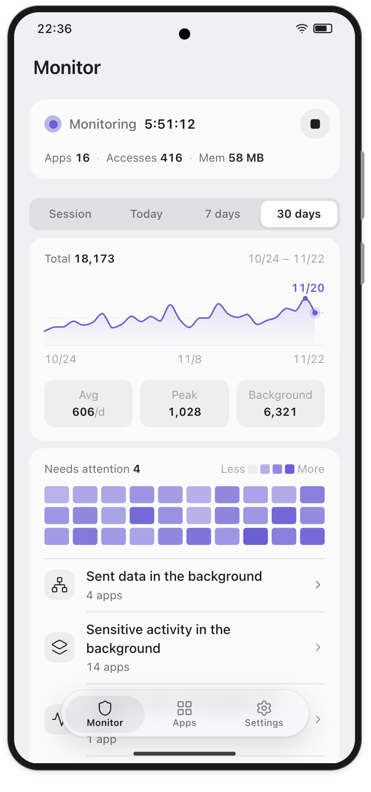
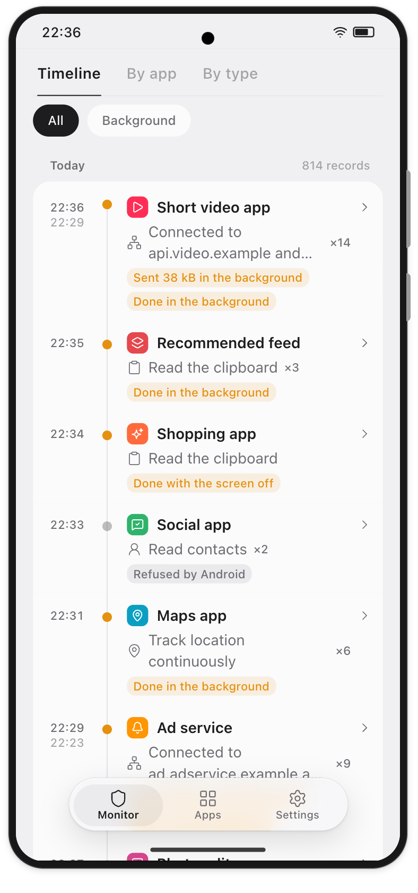
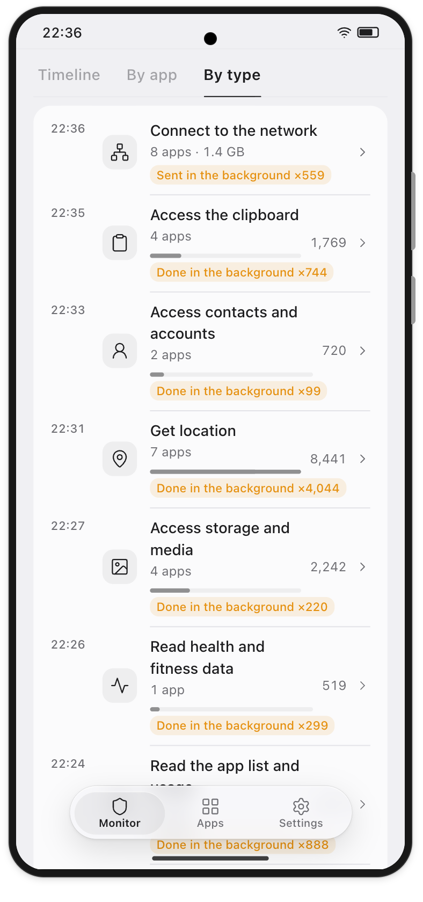
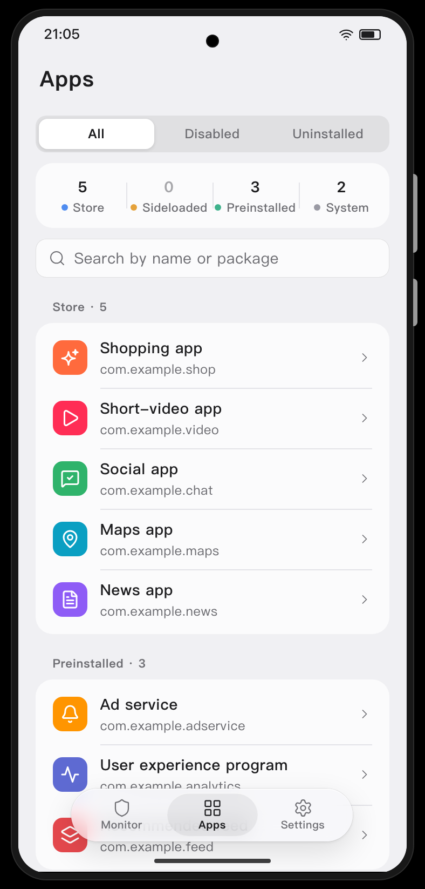
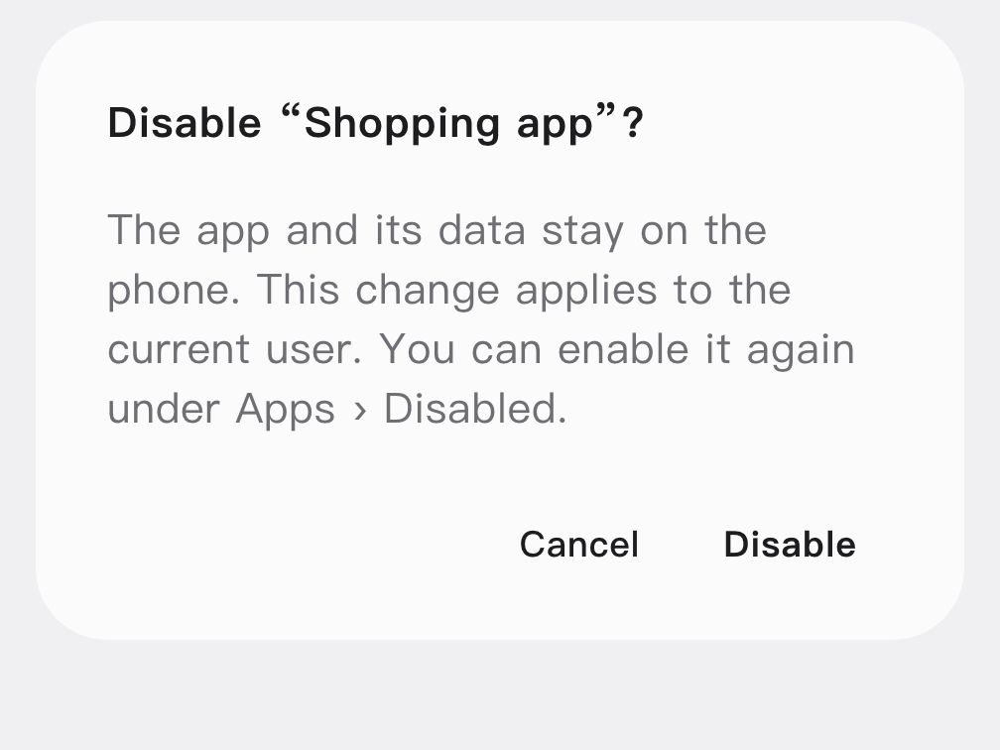
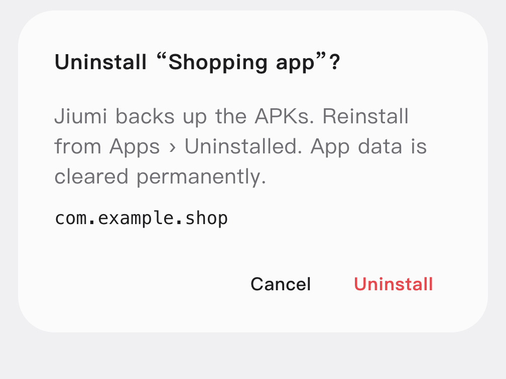
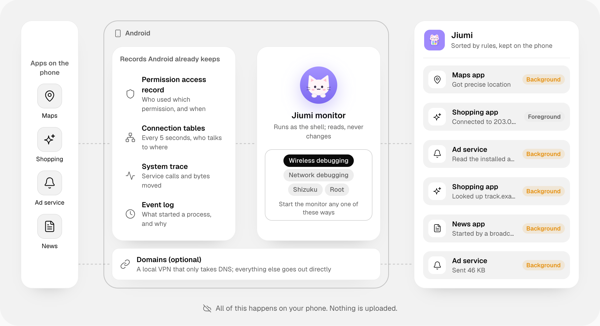

<div align="center">


# Jiumi 揪咪

Лёгкий инструмент для мониторинга активности приложений Android и управления ими.
<br>Root-доступ и компьютер не нужны. Записи хранятся на телефоне.

**[Скачать APK](https://github.com/ybblab/Jiumi/releases/latest)** · [Руководство](https://jiumi.ybblab.com/en/download/) · [Официальный сайт](https://jiumi.ybblab.com/en/)

<sub>Android 11 и новее · APK около 4 МБ · <a href="../../LICENSE">Apache 2.0</a></sub>

[简体中文](../../README.md) · [English](README.en.md) · [日本語](README.ja.md) · [한국어](README.ko.md) · [Español](README.es.md) · [Deutsch](README.de.md) · [Français](README.fr.md) · [हिन्दी](README.hi.md) · [Bahasa Indonesia](README.id.md) · [Português (Brasil)](README.pt-BR.md) · **Русский**

</div>

## Обзор приложения

<p align="center">
  <a href="../images/monitor.en.png"></a>&nbsp;
  <a href="../images/timeline.en.png"></a>&nbsp;
  <a href="../images/by-type.en.png"></a>&nbsp;
  <a href="../images/apps.en.png"></a>
</p>

## Возможности

| Возможность | Что можно сделать |
| --- | --- |
| Записи об активности | Просматривайте **56 типов доступа в 12 группах**, включая местоположение, буфер обмена и идентификаторы устройства. Записи можно просматривать по времени, приложению или типу и отфильтровывать по фоновой активности. |
| Активность, требующая внимания | Просматривайте фоновую передачу данных, обращения к конфиденциальным данным в фоне, частые обращения и попытки доступа, которые неоднократно отклонялись. |
| Сетевая активность | Просматривайте адреса соединений и доступные показатели трафика по приложениям. Если включена запись доменов, у соединений, которые удалось сопоставить с доменом, может отображаться его имя. |
| История системы | Откройте сведения о приложении, чтобы посмотреть записи об использовании разрешений и общее число таких обращений, сохранённые Android. Доступна и часть активности до начала мониторинга. |
| Экспорт журнала | В **Settings › Export logs** можно сохранить записи за выбранный период в ZIP-архиве с файлами CSV. |
| Уведомления | Во время мониторинга компактное уведомление показывает длительность сеанса и кнопку остановки. Уведомление можно отключить в **Settings › Notifications**. Оно также может показывать количество приложений и записей за сеанс. Если включить **Attention alerts**, приложение сообщит о новых событиях, требующих внимания, один раз для каждого приложения и вида события за сеанс. |

## Управление приложениями

Приложения сгруппированы по источнику установки. Откройте сведения о приложении, чтобы изучить его активность и решить, нужно ли что-либо менять. Действия по управлению запускаете вы. После каждого изменения Jiumi перечитывает состояние из Android, чтобы проверить, применилось ли оно. Если Android отклоняет изменение, Jiumi показывает причину.

<p align="center">
  <a href="../images/app-disable.en.png"></a>&nbsp;
  <a href="../images/app-delete.en.png"></a>&nbsp;
  <a href="../images/app-restore.en.png"></a>
</p>

| Действие | Результат |
| --- | --- |
| Разрешения | Включайте и отключайте разрешения по одному в разделе **Permissions** в сведениях о приложении. Переключатель **Manageable permissions** позволяет отключить сразу все управляемые разрешения. При повторном включении восстанавливаются только те разрешения, которые отключил Jiumi. Разрешения, заблокированные системой, доступны только для чтения. |
| Доступ к сети | На поддерживаемых устройствах можно блокировать и восстанавливать доступ отдельного приложения к сети через встроенный межсетевой экран Android, не занимая слот VPN. Переключатель блокируется с указанием причины, если приложение делит UID с другими приложениями, правило настроено другим инструментом или Jiumi не может подтвердить, что действие затронет только это приложение. |
| Отключить или включить приложение | Android отключает приложение для текущего пользователя. Приложение и его данные сохраняются. Включить приложение снова можно в **Apps › Disabled**. Отключённые приложения отмечены значком снежинки. |
| Снова включено | Если Jiumi обнаружит, что отключённое им приложение снова включено, в списке и сведениях появится отметка **Re-enabled**. В хронологии сохранится время обнаружения. Включите **Settings › App management › Disable again when re-enabled**, чтобы Jiumi снова отключал приложение. |
| Удалить установленное вами приложение | Введите полное имя пакета для подтверждения. Jiumi сохраняет основной APK и дополнительные APK, если они есть. Попробовать установить приложение снова можно в **Apps › Uninstalled**. **При удалении данные приложения стираются. Резервная копия содержит только установочные файлы.** |
| Удалить предустановленное приложение | Включите **Allow uninstalling preinstalled apps** в **Settings › App management**, чтобы удалять поддерживаемые предустановленные приложения для текущего пользователя. Заводская копия и данные приложения сохраняются. Попробовать восстановить приложение можно в **Apps › Uninstalled**. Удалённые приложения отмечены значком корзины. |

В разделе **Settings › App management** поле **Runs as** показывает, от чьего имени выполняются действия. При использовании root-доступа или Shizuku, запущенного от имени root, отключение и включение приложений, удаление и восстановление предустановленных приложений выполняются от имени root. Это позволяет Jiumi менять системные приложения, которые устройство запрещает менять пользователю shell. При беспроводной отладке действия выполняются от имени пользователя shell. Если устройство блокирует изменение системного приложения, Jiumi показывает причину. Удаление приложения, которое вы установили, затрагивает только текущего пользователя. Копия в рабочем профиле или во втором пространстве остаётся установленной.

Основные компоненты системы защищены по умолчанию. Изменение компонента, от которого зависит телефон, может повлиять на работу системы. Перед таким изменением Jiumi показывает предупреждение.

## Как Jiumi видит фоновую активность без root-доступа?

При работе приложений Android предоставляет записи об использовании разрешений, таблицы соединений, системные трассировки и журналы событий. Монитор Jiumi считывает доступные системные сигналы от имени **пользователя shell**. Приложение упорядочивает их по правилам и сохраняет в базе данных на телефоне. Мониторинг не внедряет код в другие приложения. Отключение или удаление приложений, отзыв разрешений и блокировку доступа к сети нужно запускать самостоятельно в разделе управления приложениями.

<p align="center"></p>

| Источник сигналов | Что может увидеть Jiumi |
| --- | --- |
| Записи об использовании разрешений (AppOps) | Какое приложение использовало разрешение и когда, а также историю, которую хранит Android. |
| Таблицы соединений | Адреса, к которым подключались приложения. По умолчанию данные считываются каждые пять секунд. |
| Системные трассировки (Perfetto) | Распознаваемые вызовы системных служб и трафик по каждому соединению, если система это поддерживает. |
| Журналы событий | Когда запустился процесс и какую причину запуска записал Android. |

**Выберите беспроводную отладку, Shizuku или root.** Во всех трёх случаях монитор работает от имени пользователя shell. Сопряжение для беспроводной отладки можно выполнить прямо на телефоне. Shizuku можно запустить через ADB или с root-доступом, после чего нужно предоставить разрешение Jiumi. В режиме root Jiumi переключается на пользователя shell для запуска монитора. Отключение и включение приложений, удаление и восстановление предустановленных приложений выполняются напрямую от имени root. Это позволяет менять приложения, которые Android запрещает менять пользователю shell. То же относится к Shizuku, запущенному от имени root.

**Необязательная запись доменов** использует локальный VPN, чтобы принимать DNS-запросы и без изменений пересылать их DNS-серверам текущей сети. Остальной трафик идёт напрямую к получателю. Запись доменов занимает системный слот VPN. Запросы через собственный шифрованный DNS приложения или частный DNS-сервер, заданный именем хоста, могут не попадать в запись.

## Скачать и запустить мониторинг

1. На телефоне с Android 11 или новее скачайте и установите APK со страницы [GitHub Releases](https://github.com/ybblab/Jiumi/releases/latest).
2. При первом запуске Jiumi выберите способ запуска. Для рекомендуемой беспроводной отладки подключитесь к Wi-Fi и следуйте подсказкам, чтобы разрешить уведомления и включить параметры разработчика. Введите в уведомлении Jiumi шестизначный код сопряжения, показанный системой.
3. На странице **Monitor** нажмите **Start monitoring**. Во время мониторинга отображается постоянное уведомление. Остановить мониторинг можно из уведомления или приложения.

После перезагрузки телефона, обновления Jiumi или перебоя в работе службы отладки Jiumi автоматически продолжит тот же сеанс, когда выбранное подключение снова станет доступно. Если в карточке отображается **Monitoring interrupted**, восстановите выбранное подключение и нажмите **Resume**. Время перерыва не включается в длительность мониторинга.

При беспроводной отладке дополнительно включённая отладка по USB помогает сохранить работу монитора, если Android отключит беспроводную отладку при потере Wi-Fi. Сохранение подключения ADB по умолчанию выключено. Если его включить, порт будет использован повторно только при наличии на устройстве уже проверенной службы, слушающей на петлевом интерфейсе. Подробности есть в [руководстве по настройке](https://jiumi.ybblab.com/en/download/).

## Конфиденциальность и ограничения

- **Записи хранятся на телефоне.** В Jiumi нет учётных записей, а записи мониторинга не выгружаются. Приложение может проверять обновления на GitHub. Если вы выберете обновление, Jiumi скачает APK и проверит его размер, контрольную сумму SHA-256 и подпись. Проверку обновлений можно отключить.
- **Записи описывают активность и соединения.** Jiumi может показать, что разрешение использовалось или что в доступе было отказано. Приложение не видит сообщения, пароли или содержимое сетевого трафика.
- **Полнота данных зависит от системы.** Короткие соединения могут завершиться между замерами, а такие действия, как прямое чтение файлов, могут не оставлять доступных сигналов. Статистика трафика по каждому соединению требует Android 14 или новее и поддержки со стороны системы. Jiumi опускает часть неподтверждённой активности, чтобы уменьшить число ложных сообщений.
- **Мониторинг увеличивает расход заряда.** Расход зависит от активности приложений. Когда мониторинг больше не нужен, остановите его из уведомления.

## Сборка из исходного кода

Требуются JDK 17 и Android SDK.

```sh
cd code
./gradlew :app:assembleDebug
```

Категории мониторинга, правила оповещений и защищённые приложения настраиваются в [каталоге правил](../../code/app/src/main/assets/rules/). Структура кода и порядок участия в проекте описаны в [CONTRIBUTING.md](../../CONTRIBUTING.md).

## Участие в проекте и лицензия

Мы приветствуем сообщения о проблемах и запросы на внесение изменений. О проблемах безопасности сообщайте приватно по инструкции в [SECURITY.md](../../SECURITY.md).

Jiumi распространяется по [лицензии Apache 2.0](../../LICENSE). Сторонние компоненты и их лицензии перечислены в [NOTICE](../../NOTICE). Используйте Jiumi на устройствах, которыми вы владеете или на использование которых у вас есть разрешение.

## История звёзд

<a href="https://www.star-history.com/#ybblab/Jiumi&amp;Date">
  <picture>
    <source media="(prefers-color-scheme: dark)" srcset="https://api.star-history.com/svg?repos=ybblab/Jiumi&amp;type=Date&amp;theme=dark" />
    
  </picture>
</a>

<div align="center">

**Если Jiumi помогает вам понять, что делают ваши приложения, поставьте проекту ⭐ на GitHub.**

</div>
